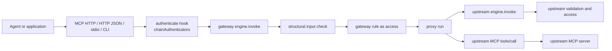

# Action Engine gateway

- Status: Accepted through [ADR 0052](./adr/0052-per-caller-capability-visibility.md),
  [ADR 0053](./adr/0053-action-engine-gateway-package.md), and
  [ADR 0054](./adr/0054-search-based-tool-discovery.md). This note keeps the
  design rationale, measurements, and prototype history. The normative
  contract is AE-VIS-01 and AE-GATEWAY-01..06 in
  [architecture and contracts](./architecture.md); where this note differs, the
  contract and the ADRs win.
- Date: 2026-11-07, accepted 2026-11-09
- Applies to: `@invokta/gateway`; the optional `visibility` option of
  `@invokta/mcp` and `@invokta/http`; no change to `@invokta/core`

An **Action Engine gateway** publishes the capabilities of several Action
Engines and MCP servers through one endpoint and enforces the authentication
and authorization rules that the team operating the gateway configures.

This note answers four questions:

1. Can a gateway be built on the existing contracts without a second
   execution path?
2. Where do authentication, authorization, and upstream credentials belong?
3. How do clients discover tools when a gateway publishes hundreds of them?
4. Which accepted limits does a gateway touch, and what must an ADR decide
   before the package ships?

## Summary of the recommendation

**The gateway is a capability map, not a new runtime.** `createGateway`
turns explicitly configured upstreams into ordinary capabilities whose `run`
forwards to the upstream `engine.invoke` or MCP `tools/call`, and whose
`access` comes from the gateway's rules. The host passes that map to
`createEngine` and serves the resulting engine with the existing adapters:

```text
agent / app ──> MCP HTTP or HTTP JSON adapter ──authenticate──> gateway engine.invoke
                                                                  │ validate (structural)
                                                                  │ access = gateway rule
                                                                  └─ run ──┬─> upstream engine.invoke  (its own validation + access)
                                                                           └─> upstream MCP tools/call (service credential)
```

Consequences:

- **One execution path.** Every adapter still calls only `engine.invoke`
  (AE-ARCH-03). The gateway adds no adapter, transport, error code, event,
  context field, or pipeline stage.
- **Two enforcement points.** The gateway's rule runs as the capability's
  `access` stage; an upstream engine still runs its own `access` afterwards.
  The gateway can only narrow access, never widen it.
- **Everything composes.** `onEvent`, `@invokta/otel`, `applyMiddleware`
  (rate limits, quotas, caching), `@invokta/tooling`, the CLI, MCP stdio, the
  devtools, and the installer work on a gateway engine unchanged.

The proof of concept implements this design in about 1,200 lines of source
without changing an existing package.

For catalogs of hundreds of tools, the plan adds per-caller visibility
(option D, phase 2) and opt-in search-based discovery (option C, phase 3). D
is the only planned change to existing packages: an optional adapter option.
See [Tool discovery at scale](#tool-discovery-at-scale).

## Evidence

The proposal follows the extraction rule of AE-SCOPE-04 and must meet it
before an ADR:

| Evidence | Where |
| --- | --- |
| Hosts already publish several engines behind one origin as a "Gateway" resource | ADRs [0039](./adr/0039-configurable-mcp-http-mount-path.md) and [0040](./adr/0040-installer-mounted-mcp-urls.md), issue #75 |
| Engines repeat the same authentication integration | ADR [0049](./adr/0049-jwt-bearer-authentication-helper.md): nine authentication examples |
| A plain-type MCP client facade already exists | `connectMcpClient` in `@invokta/mcp` |
| Consumers must install and authenticate every engine separately | `@invokta/installer` manages one entry per engine and client |

Still missing, and required before promotion: at least two real deployments
that aggregate upstreams they do not own, and a decision on the tensions
listed under [Relationship to accepted contracts](#relationship-to-accepted-contracts).

## Topologies

| Topology | What the consumer sees | Status |
| --- | --- | --- |
| **Aggregating** (fan-in) | One MCP server or HTTP API whose catalog combines namespaced capabilities from every upstream | Implemented by the proof of concept |
| **Mounting** (multiplexing) | One origin with one endpoint per engine, for example `/e/billing/mcp`, each with its own audience and Protected Resource Metadata | Possible today with ADR 0039 and 0042 handlers; a router helper is phase 5 |

Aggregation is the gateway proper: one installation, one credential, and one
policy for many engines. Mounting keeps one resource identifier per engine
and suits audience-bound OAuth tokens. Both are host compositions over the
same adapters.

## Architecture



### Request lifecycle

1. The adapter validates Host, Origin, route, method, and body bounds as it
   does today.
2. The adapter's `authenticate` hook returns a `Principal` or `null`.
   `chainAuthenticators` lets one gateway accept several methods, for example
   `@invokta/auth-jwt` for users and `apiKeyAuthenticator` for services.
3. `engine.invoke` resolves the gateway capability and runs the structural
   input check.
4. The capability's `access` is the gateway rule bound at construction. A
   throwing rule is a denial, never an execution failure. The decision is
   reported to `onDecision` without input, output, or credentials.
5. `run` forwards to the upstream with the caller's signal; for an engine
   upstream also the request ID, the mapped principal, and the progress sink.
6. The upstream result is returned; an upstream `DOMAIN_ERROR` is raised again
   as the same declared domain error, and every other failure keeps its public
   code or is normalized by the core.

## Configuration surface (proof of concept)

```ts
import { createEngine } from "@invokta/core";
import { serveMcpHttp, connectMcpClient } from "@invokta/mcp";
import { createJwtBearerAuthenticator } from "@invokta/auth-jwt";
import {
  apiKeyAuthenticator,
  chainAuthenticators,
  createGateway,
  engineUpstream,
  mcpUpstream,
  requireScopes,
} from "@invokta/gateway";

const gateway = createGateway({
  upstreams: [
    engineUpstream({ name: "support", engine: supportEngine }),
    await mcpUpstream({
      name: "docs",
      namespace: "kb",
      connection: await connectMcpClient(docsTarget),
      include: ["search", "fetch"],
      pin: process.env.DOCS_CATALOG_FINGERPRINT,
      timeoutMs: 10_000,
    }),
  ],
  rules: [
    { name: "no-deletes", match: "kb.delete", access: "deny" },
    { name: "kb-read", match: "kb.*", access: requireScopes("kb:read") },
    { name: "support", match: "support.*", access: "authenticated" },
  ],
  // defaultAccess: "deny" is the default.
  onDecision: (decision) => audit.write(decision),
});

const engine = createEngine({
  name: "acme-gateway",
  version: "1.0.0",
  capabilities: gateway.capabilities,
});

await serveMcpHttp(engine, {
  auth: {
    mode: "required",
    authenticate: chainAuthenticators(
      createJwtBearerAuthenticator(jwtOptions),
      apiKeyAuthenticator({ keys: serviceKeys }),
    ),
  },
});
```

| Export | Responsibility |
| --- | --- |
| `engineUpstream` | Snapshot an in-process engine's catalog through `list` and `describe`; forward to its `invoke` |
| `mcpUpstream` | Snapshot a connected MCP server's tools once, with bounded pagination and an optional pinned fingerprint; forward to `callTool` |
| `createGateway` | Bind each capability to its first matching rule; return the capability map and the route table |
| `chainAuthenticators` | Try several `authenticate` hooks in order |
| `apiKeyAuthenticator`, `hashApiKey` | Static service keys stored as SHA-256 digests |
| `requireScopes` | Access function over `principal.attributes.scopes`, the `@invokta/auth-jwt` default mapping |
| `gateway.visibility` | Per-caller visibility derived from the rules, for the adapters' `visibility` option ([D](#d--per-caller-visibility)) |
| `createDiscovery` | Search-based discovery: `search-tools`, `invoke-read-tool`, `invoke-tool`, and `alwaysList` over the gateway ([C](#c--search-based-discovery)) |

## Authentication

Authentication stays where ADR 0007 put it: the HTTP adapters' required
`authenticate` hook, before `engine.invoke`. The gateway adds only
composition:

- `chainAuthenticators` returns the first non-null principal. A method that
  throws stops the chain, so an unavailable key set yields the adapter's
  sanitized 500 instead of a silent fallback to a weaker method.
- `apiKeyAuthenticator` accepts one header (default `x-api-key`), keeps only
  digests in configuration, bounds the presented key to 1,024 characters, and
  compares against every digest without an early exit.
- Local channels (stdio, CLI, direct) keep the host-supplied principal of
  AE-CLI-01 and AE-MCP-03.

The gateway does not issue tokens, perform login, or introspect tokens
(AE-LIMIT-04).

## Authorization

A rule is `{ name?, match, access }`. `match` is an exact capability ID,
`prefix.*`, or `*`. `access` is `public`, `authenticated`, `deny`, or a
function receiving `{ principal, input, context, route }`. Semantics:

- **First match wins**, in configuration order, like a firewall rule list.
  Binding happens once, at construction, and `gateway.routes` publishes which
  rule governs every capability so the policy can be reviewed and snapshot
  tested.
- **Deny by default.** Unmatched capabilities get `defaultAccess`, which is
  `deny` unless configured.
- **Fail closed.** A rule that throws or rejects denies and logs a
  payload-free warning; the outcome is reported as `failed`.
- **Strict configuration.** A rule or `include` pattern that matches nothing
  fails construction, so a typo cannot silently drop a deny rule.
- **Defense in depth.** An engine upstream still enforces its own `access`.
  `principal` on `engineUpstream` maps the gateway caller to the identity the
  upstream receives.

This is a routing table that assigns an access rule to each capability. The
decisions themselves remain functions or core access kinds; a rule may call a
PDP exactly as [capability authorization](./capability-authorization.md)
describes.

## Upstreams

### Engine upstream

- The catalog is read once from `list` and `describe`; `include` narrows it.
- Contracts are republished unchanged: title, description, schemas,
  annotations, deprecation, and declared domain errors.
- `run` calls the upstream `engine.invoke` with the gateway request ID,
  source, mapped principal, signal, and progress sink, so upstream validation,
  access, timeout, events, and progress all apply.
- The core never preserves a thrown `DOMAIN_ERROR`, so the gateway redeclares
  each upstream domain error and raises it again as a `CapabilityError`; the
  caller sees the same code, retry hint, and details.

### MCP upstream

- The host owns the MCP client connection, its credentials, and its lifetime.
  The gateway depends only on a structural `listTools`/`callTool` interface
  that `McpClientConnection` satisfies, so the package does not depend on the
  MCP SDK.
- Discovery runs once at the composition root: at most 64 pages and
  `maxTools` tools (default 256, at most 4,096). A duplicate tool name or an
  input or output schema without an object root fails startup.
- The gateway publishes `<namespace>.<tool>`; the namespace defaults to the
  upstream name.
- `fingerprint` is the SHA-256 of the canonical JSON of the published tools.
  With `pin`, any change to a tool's name, description, schemas, or
  annotations fails startup: a defense against MCP tool poisoning and silent
  description changes.
- Every tool call has a finite timeout (default 30,000 ms) and receives the
  invocation signal (AE-CONNECTOR-02).
- A tool with an output schema returns its `structuredContent`; one without
  returns `{ content }`. A tool error becomes the declared domain error
  `UPSTREAM_TOOL_ERROR` with the first text block, truncated to 1,024
  characters.

### Upstream credentials

The caller's credential is **never forwarded** to an upstream. Passing an
inbound token through creates a confused deputy and breaks audience binding;
the MCP authorization specification forbids it. In the proof of concept each
MCP upstream uses one service credential held by the host. Per-caller
upstream credentials, through token exchange or a connector broker, are
phase 6 and reuse the `CredentialSource` port of
[connector brokers](./connector-brokers.md).

## Tool discovery at scale

The gateway discovers upstream tools once, at startup (see
[MCP upstream](#mcp-upstream)). Clients have no comparable mechanism: every
caller receives the complete published catalog in one `tools/list` response,
including capabilities it is not allowed to call.

### Measured baseline

Measured with the proof of concept against a real upstream MCP engine whose
tools have one-line descriptions and two-property input schemas. Token counts
use a rough estimate of 4 bytes per token; real tools with longer
descriptions and schemas cost several times more.

| Upstream tools | Configuration | Startup discovery | One client `tools/list` |
| --- | --- | --- | --- |
| 200 | default | 182 ms | 200 tools, about 97 KB (about 24,000 tokens) |
| 300 | default | Fails: more than the default 256 tools | — |
| 300 | `maxTools: 500` | 110 ms | 300 tools, about 145 KB (about 36,000 tokens) |
| 200 or 300 | `include` of 3 tools | — | 3 tools |

Hundreds of tools consume the client's context in every conversation and
degrade the model's tool selection. Some clients, such as Claude Code, defer
large MCP tool sets and search them on demand; the gateway cannot rely on
every client doing so.

### Options considered

| Option | Mechanism | Plan |
| --- | --- | --- |
| A — Curation | `include` per upstream | Available in the proof of concept |
| B — Profiles per audience | One mount per audience with its own subset | Covered by the mounting router (phase 5) for audience-bound OAuth, not as the discovery answer |
| **C — Search-based discovery** | The client sees a constant, small set of tools and searches the catalog on demand | **Planned: phase 3** |
| **D — Per-caller visibility** | Each caller lists, describes, and calls only capabilities its rules can allow | **Planned: phase 2** |

D comes first because C depends on it: search results must never include a
capability the caller cannot see.

### D — Per-caller visibility

> Prototyped on this branch: `visibility` in `@invokta/mcp` and
> `@invokta/http`, and `gateway.visibility`. The adapter change still needs
> its ADR before it can merge.

**Goal.** A caller lists, describes, searches, and calls only the
capabilities that its gateway rules could allow. A hidden capability is
indistinguishable from a nonexistent one.

**Mechanism: an optional adapter hook, not a core change.** The core's
`list` and `describe` stay principal-free (AE-ENG-01), so contract snapshots,
`validateMcpToolCatalog`, and tool-name collision detection still cover the
complete catalog. The adapters gain one optional, synchronous option:

```ts
type CapabilityVisibility = (args: {
  readonly principal: Principal | null;
  readonly capabilityId: string;
}) => boolean;
```

- `@invokta/mcp`: `createMcpHttpHandler`, `serveMcpHttp`, and
  `serveMcpStdio` accept `visibility`. MCP HTTP already creates one protocol
  server per request with the authenticated principal (`createMcpServer` in
  `http-protocol.ts`), so the `tools/list` handler in `protocol-server.ts`
  filters the frozen catalog, and `tools/call` answers a hidden tool with the
  same `Tool <name> not found` protocol error as an unknown tool, without
  calling `engine.invoke` or emitting an event. stdio evaluates visibility
  with the host-configured principal.
- `@invokta/http`: `GET /capabilities` returns only visible capabilities;
  `GET` and `POST /capabilities/{id}` answer a hidden ID with the same 404
  `CAPABILITY_NOT_FOUND` as an ID outside the catalog, before reading the
  body; `GET /openapi.json` is generated from the visible set and cached per
  distinct visible set.
- `@invokta/gateway` exports `gateway.visibility`, compiled from the rules:
  `public` is visible to every caller, `authenticated` to every non-null
  principal, `deny` to nobody, and `requireScopes` to principals holding the
  scopes. An access function may depend on input, which a listing does not
  have, so a rule with a custom function MAY declare
  `visible?: (principal, route) => boolean`. The route lets one rule show
  reads and writes to different callers; the predicate stays synchronous and
  never sees input. Without it, the capability is visible to every
  authenticated caller: a listing grants nothing, and the access rule still
  decides every call.

**Rules.**

- Visibility never grants access. A visible capability still passes its
  access rule on every call, and can still be `FORBIDDEN` for a particular
  input, for example a tenant mismatch.
- The predicate is synchronous and reads only the principal, so listing 200
  tools costs 200 predicate calls and no I/O.
- Entitlements that need a PDP or directory lookup are resolved once per
  request by the `authenticate` hook, which already performs asynchronous I/O
  with the request signal, and mapped into compact `principal.attributes`
  such as scopes or roles. Visibility reads them synchronously; the access
  rule may still ask the PDP when a call is made.
- The predicate receives a deep-frozen copy of the principal, so it cannot
  change the identity that reaches `invoke`. Anything but a returned `true`,
  including a throw, hides the capability.
- MCP clients cache tool lists. A change to a caller's scopes appears the
  next time the client lists tools; stateless HTTP sends no
  `notifications/tools/list_changed` (AE-LIMIT-05).

**Acceptance criterion.** With the demo rules, `reader` lists only
`billing_get-invoice` and `support-agent` lists all three tools. `reader`
calling `billing_refund` receives a protocol error byte-identical to a call
of a nonexistent tool, and no engine event is emitted. The HTTP adapter
answers 404 for a hidden describe or invoke, and each principal's OpenAPI
document contains only its visible operations.

### C — Search-based discovery

> Prototyped on this branch: `createDiscovery` in `@invokta/gateway`, with
> annotation trust in `mcpUpstream`.

**Goal.** A client sees a small, constant number of tools whatever the
catalog size, and discovers the rest on demand without losing per-tool
authorization.

**Shape.** `createDiscovery({ gateway, … })` in `@invokta/gateway` returns
`{ capabilities, visibility, gatewayEngine }`. The host serves
`capabilities` as a separate engine with `visibility` as its adapter option:

| Capability | Annotations | Contract |
| --- | --- | --- |
| `<prefix>.search-tools` | `readOnly` | Input `{ query, limit? }`: a query of 1 to 256 characters and 1 to 20 results, 8 by default. Output `{ tools, truncated }`: each entry has the ID, title, description, input and output schemas, annotations, and deprecation of one visible capability |
| `<prefix>.invoke-read-tool` | `readOnly` | Input `{ tool, arguments }`; accepts only targets whose read-only status is trusted |
| `<prefix>.invoke-tool` | `destructive`, `openWorld` | Input `{ tool, arguments }`; accepts every visible target |

Splitting invocation by risk class keeps client confirmation meaningful. A
client that asks before destructive tools asks before every `invoke-tool`
call and never before a read. A single generic tool would either prompt for
every read or never prompt for a deletion. A read sent to `invoke-tool` is
accepted: it costs a confirmation, never a bypass.

The discovery tools have no authority of their own: their access is
`public`, they are visible to every caller, and every decision is delegated
to `gateway.visibility` and to the target's gateway rule.

**Annotation trust.** MCP tool annotations are hints that the upstream
server chooses, and the MCP specification tells clients to treat them as
untrusted unless the server is trusted. An upstream that marks a deletion
`readOnlyHint: true` must not route it to `invoke-read-tool`, where a client
may run it without confirmation. Read-only status is therefore trusted only
for engine upstreams, which are code the host composes, and for MCP tools
that the operator vouches for, either with `trustAnnotations: true` on the
upstream or by name in `readOnlyTools`. Every other MCP tool goes to
`invoke-tool`. The same rule governs which read-only hints the gateway
republishes for MCP upstreams, and the pinned fingerprint already detects a
changed annotation.

**`alwaysList`.** An optional list of capabilities published directly, next
to the three discovery tools, so the most frequent ones keep their typed
contract and their own annotations (a hybrid catalog). It accepts exact IDs
or the rule pattern grammar and is chosen by configuration only. Every
pattern must match, the expanded list holds at most 32 capabilities (about
15 KB, roughly 4,000 tokens, at the measured size), and each entry is still
subject to the caller's visibility. Usage data such as the
`invokta.invocations` metric of `@invokta/otel` can inform a reviewed change
to the list; the gateway never reorders it from usage.

**Execution path.** The `invoke-*` handlers call the gateway engine's
`engine.invoke(target, arguments, …)` with the caller's principal, signal,
request ID, source, and progress sink. The target's gateway rule, input
validation (phase 1), upstream access, timeout, events, and authorization
decision apply exactly as for a direct call. The path stays single: outer
adapter, discovery engine `invoke`, gateway engine `invoke`, upstream.

`createDiscovery` builds that gateway engine itself from
`gateway.capabilities` and returns it as `gatewayEngine`; the host can name
it, attach `onEvent` and `logger`, and serve it as the full catalog. It does
not accept an engine from the host: an engine built from the upstreams
instead of the gateway would let `invoke-tool` bypass every gateway rule.

**Errors.**

| Situation | Result |
| --- | --- |
| Unknown or hidden target | Declared domain error `TOOL_NOT_FOUND`, identical in both cases |
| Non-read-only target sent to `invoke-read-tool` | Declared domain error `TOOL_NOT_READ_ONLY` naming the tool |
| Target fails with a framework code (`INPUT_INVALID`, `FORBIDDEN`, `CANCELLED`, …) | The same code |
| Target raises a declared domain error | `TOOL_DOMAIN_ERROR` with `{ tool, code, retryable, details? }`, because ADR 0045 allows at most 64 declarations per capability |

**Ranking.** The default is deterministic, lexical BM25 built once from the
frozen catalog: no network, no model, no data leaves the gateway, and the
same query always returns the same tools, so results can be tested.

- Fields are weighted: ID segments and title above description.
- A query equal to a capability ID returns that capability first, so a
  model can fetch the schema of a tool it already knows.
- Tokens are split on `.`, `-`, `_`, whitespace, and camelCase boundaries,
  lowercased, and folded to remove diacritics, so `cobrança` matches
  `cobranca`.
- Regular plurals are folded to the singular on both sides: `tickets`,
  `addresses`, `matches`, `categories`, and `pedidos` match their singular.
  Without it the prototype missed `search tickets by keyword`, and
  `list meetings` hit only through the ID tie-break. There is no other
  stemming, no synonym list, and no translation.
- The `search-tools` description tells the model to search with the action
  and the object in the catalog's language, for example `refund invoice`.
  The language is configurable and defaults to English.

Lexical search does not cross languages: a Portuguese query does not find an
English description. The prototype suite records recall@8 for ten English
and ten Portuguese queries against the 200-tool fixture:

| Query set | recall@8 | Expected tool first |
| --- | --- | --- |
| English, without plural folding | 0.9 | — |
| English, with plural folding | 1.0 | 10 of 10 |
| Portuguese | 0.0 | 0 of 10 |

A host MAY inject a `rank` port, for example embedding search, a decision
model that judges which tools a task needs, or a glossary that expands the
query before the exported `createSearchIndex` runs, as
`(query, candidates, { signal }) => Promise<string[]>` with a
finite timeout. Its result is intersected with the visible candidate IDs, so
a ranker can reorder or drop tools but never add one; a failing or timed-out
ranker falls back to the lexical result. Invokta provides no embedding or
retrieval abstraction (AE-LIMIT-03); the port and its implementation are
host-owned.

**Bounds and audit.** At most 20 results and a 64 KiB response budget:
results that would exceed it are dropped from the tail and `truncated` is
`true`; a schema is returned whole or not at all. `onSearch` records a
search with the request ID, principal ID, result count, `truncated`, and
the ranker used (`lexical`, `custom`, or `lexical-fallback`), never the
query text, which may contain sensitive data. Each invocation produces the
target's normal gateway decision.

**Where to serve it.** A host may publish the full, visibility-filtered
catalog at `/mcp` for clients with native tool search, and the discovery
engine at `/search/mcp` for clients without it. Both paths satisfy the
mount-path rule of ADR 0039.

**Costs.**

- `invoke-tool` is a generic execution entry point, the kind of
  infrastructure interface AE-INV-01 rejects as a domain action. It is
  published only by a gateway, never by an Action Engine, and every target
  remains a domain capability addressable by its own ID. The ADR must accept
  this explicitly.
- Three tools stand for N capabilities, which departs from "one capability,
  one tool" (AE-MCP-01) at the protocol surface.
- The `invoke-*` output is `{ result }` with a generic schema; typed
  `structuredContent` and rich content blocks of the target are not
  reproduced.
- Search then invoke adds a round trip and depends on the model searching
  well; `alwaysList` mitigates the most frequent cases.
- Tool descriptions reach the model through search results, as they do
  through `tools/list`; catalog pinning and the phase 4 lock file still
  apply.

**Acceptance criterion.** With a 200-tool fixture, a client lists exactly
three tools plus `alwaysList`. `search-tools` returns at most `limit`
visible tools with their schemas. `invoke-read-tool` with a destructive
target fails as `TOOL_NOT_READ_ONLY`, and so does an MCP tool whose only
read-only evidence is an untrusted hint. A hidden target and an unknown
target produce identical `TOOL_NOT_FOUND` errors. Every invocation produces the same
gateway decision and upstream result as a direct call of the target. The
prototype meets this criterion; see
[Proof-of-concept validation](#proof-of-concept-validation).

## Security model

| Threat | Control in the proof of concept |
| --- | --- |
| Anonymous access to a protected upstream | Adapter `authenticate` is required; default rule is `deny` |
| A typo removes a deny rule | Rules and include patterns must match at least one capability |
| An unavailable PDP grants access | Throwing or rejecting rules deny (`failed` outcome) |
| The gateway widens an upstream's policy | Upstream engines still enforce their own `access` |
| Tool poisoning or a silent catalog change | Catalog frozen at startup; optional pinned fingerprint |
| Confused deputy through token passthrough | Caller credentials never reach upstreams; service credentials per connection |
| An upstream hangs or floods | Finite tool timeout, bounded discovery, truncated error messages; the core enforces the lossless JSON model |
| Audit leaks payloads or secrets | `onDecision` carries IDs, rule name, and outcome only; failures in the sink are contained |
| Static key disclosure from configuration | Only SHA-256 digests are configured |

Controls for tool discovery, prototyped for phases 2 and 3:

| Threat | Control |
| --- | --- |
| A caller enumerates capabilities it cannot use | Hidden capabilities are absent from `tools/list`, HTTP listing, OpenAPI, and search, and answer exactly like nonexistent ones |
| A generic invoke tool widens access | `invoke-*` calls the target through the gateway `engine.invoke`, so the target's rule, validation, and upstream access apply |
| A generic invoke tool bypasses client confirmation | Invocation is split into `invoke-read-tool` and a `destructive` `invoke-tool` |
| An upstream marks a destructive tool read-only | Read-only routing trusts only engine upstreams, `trustAnnotations`, or `readOnlyTools` |
| A ranker injects or reveals a tool | Ranker output is intersected with the caller's visible candidates |
| Search queries leak into audit logs | Searches record only IDs and the result count |

## Relationship to accepted contracts

| Contract | Proof of concept | Decision needed |
| --- | --- | --- |
| AE-ARCH-03 single path | Respected: adapters call only `engine.invoke`; proxies call upstream `engine.invoke` or `tools/call` | None |
| AE-ARCH-04 portability | Uses only Web globals (`crypto.subtle`, `structuredClone`) | Add the package to the portability test when promoted |
| AE-SCHEMA-02, AE-INV-02 validation | **Tension**: the gateway checks only that input and output are JSON objects; the upstream validates | Phase 1 adds a host-injected JSON Schema validator port |
| AE-LIMIT-02 no remote registry or discovery | **Tension**: MCP tools are listed over the network once, at the composition root, explicitly configured, and optionally pinned | Accept startup discovery as explicit composition, or require a committed catalog lock file |
| AE-LIMIT-04, scope matrix: no policy language | **Tension**: rules are a first-match routing table over capability IDs; decisions stay functions | Accept the routing table as configuration rather than a policy language |
| AE-SCOPE-01 package inventory | A fourteenth package, private for now | An ADR adds `@invokta/gateway` as an optional runtime helper |
| AE-INV-01 capability first; "a server that merely mirrors APIs is not an Action Engine" | The gateway is infrastructure, not an Action Engine; it republishes upstream domain IDs under a namespace | Document the gateway as a host composition, never as a domain engine |
| Maturity level E, federated platform | Out of scope: no registry, tenancy, rollout, control plane, or dynamic catalog | Keep explicit in the ADR |
| AE-OBS-01 single hook | `onDecision` is a gateway option, not an engine hook; engine events are unchanged | Decide whether decisions stay a gateway option or become an `onEvent` recipe |
| AE-ACCESS-01 published access kind | Every gateway capability publishes `access: "function"` | Accept, or publish the bound kind when the rule is `public` or `authenticated` |
| AE-ENG-01 `list` and `describe` | Unchanged; D filters in the adapters, not the core | None for the core |
| AE-MCP-01, AE-HTTP-01, AE-HTTP-02 adapter behavior | D adds an optional `visibility` option; a hidden capability answers like a nonexistent one | An ADR for the adapter option and its error equivalence |
| AE-INV-01, AE-MCP-01 for the discovery engine | C publishes three generic tools for N capabilities | Accept `invoke-*` as gateway-only infrastructure, or reject C |
| ADR 0045 declared domain errors | C wraps target domain errors as `TOOL_DOMAIN_ERROR` | Accept the wrapping |
| AE-LIMIT-03 no retrieval abstraction | C ranks lexically; semantic ranking only through a host-owned port | Confirm the port is not a retrieval abstraction |
| AE-LIMIT-05 no server-to-client notifications | Visibility changes appear on the client's next `tools/list` | None |

## Known limitations found by the proof of concept

- **Input errors from MCP upstreams arrive as `UPSTREAM_TOOL_ERROR`.** The
  demo shows an upstream Invokta engine's `INPUT_INVALID` wrapped as a domain
  error with the serialized upstream error as its message. The validator port
  of phase 1 rejects invalid input before the call, as `INPUT_INVALID`.
- **Rules that read `input` see unvalidated data.** Until the validator port
  exists, a rule must treat `input` as untrusted.
- **Per-caller visibility is an unaccepted adapter change.** The prototype
  adds `visibility` to `@invokta/mcp` and `@invokta/http`; it needs its ADR
  before merging. MCP stdio accepts and validates the option and shares the
  filtered protocol server with HTTP, but no test drives a stdio session with
  it yet.
- **`gateway.visibility` hides every capability the gateway did not
  create.** A host that mixes gateway and local capabilities in one engine
  composes its own predicate.
- **Discovery cannot wrap the gateway engine in middleware.**
  `createDiscovery` builds the gateway engine from `gateway.capabilities` so
  `invoke-tool` cannot bypass the rules; `applyMiddleware`, for example a
  rate limit per target, is not available on that engine yet.
- **`invoke-*` results are generic.** The output is `{ result }`; the
  target's typed `structuredContent` and rich content blocks are not
  reproduced at the protocol surface.
- **Rich MCP content is not reconstructed.** A proxied tool without an output
  schema returns `{ content }` as structured data; images and audio are not
  re-emitted as content blocks.
- **No upstream lifecycle.** A dropped stdio or HTTP connection fails calls
  with `EXECUTION_FAILED` until the host reconnects and restarts.
- **Request IDs are shared with engine upstreams** for correlation. Hosts
  that attach one `@invokta/otel` handler to both the gateway and an upstream
  engine must use separate handlers.

## Limits (proof of concept)

| Dimension | Limit |
| --- | --- |
| Upstream name and namespace | 1-64 lowercase letters, digits, or inner hyphens |
| Rule pattern | `*`, an exact ID, or `prefix.*` |
| MCP tools per upstream | 256 by default, at most 4,096 |
| MCP `tools/list` pages per upstream | 64 |
| MCP tool call timeout | 30,000 ms by default; 1 through 2,147,483,647 ms |
| Upstream tool error message | 1,024 characters |
| Presented API key | 1,024 characters |
| `search-tools` query and results | 256 characters; 1 to 20 results, 8 by default |
| `search-tools` response | 64 KiB; a tool entry is returned whole or not at all |
| `invoke-*` tool ID | 256 characters |
| `alwaysList` | 32 capabilities after pattern expansion |
| Host ranker deadline | 2,000 ms by default; 1 through 60,000 ms |
| HTTP OpenAPI documents cached per visible set | 64; the oldest is evicted |

## Delivery plan

Each phase is one cohesive, test-first deliverable with its own acceptance
criterion.

| Phase | Deliverable | Acceptance criterion |
| --- | --- | --- |
| 0 — Proof of concept | Private `packages/gateway`, tests, runnable demo, this note | Engine and MCP upstreams are served through MCP HTTP and HTTP JSON with chained authentication, first-match rules, default deny, decision audit, and pinned MCP catalogs; repository gates pass |
| 1 — Contract hardening | JSON Schema validator port injected by the host; ADR; package public API types test; architecture and portability tests; recipe and docs-site reference | Invalid input to any upstream fails as `INPUT_INVALID` before `run`; the ADR resolves every tension above |
| 2 — Per-caller visibility (D) | **Prototyped.** Optional synchronous `visibility` option in `@invokta/mcp` and `@invokta/http`; `gateway.visibility` compiled from the rules, with optional `visible` on custom function rules. Remaining: ADR for the adapter change, adapter references, stdio session test | The [D acceptance criterion](#d--per-caller-visibility) |
| 3 — Search-based discovery (C) | **Prototyped.** `createDiscovery` with `search-tools`, `invoke-read-tool`, `invoke-tool`, bounded `alwaysList`, BM25 ranking with plural folding, annotation trust, and the optional `rank` port. Remaining: middleware on the gateway engine, ADR | The [C acceptance criterion](#c--search-based-discovery) |
| 4 — Catalog lock | `invokta gateway lock` in `@invokta/tooling`: write the MCP catalog snapshot and fingerprints to a committed file; the gateway verifies it at startup | A changed upstream tool fails startup and `yarn check` with a reviewable diff |
| 5 — Mounting router | Web-standard router that serves several MCP and HTTP handlers, each with its own mount path, authenticator, and Protected Resource Metadata | One origin serves `/e/<engine>/mcp` per engine and passes the installer's mounted-URL tests |
| 6 — Delegated credentials | Per-principal upstream credentials through the connector-broker `CredentialSource` port, including RFC 8693 token exchange | A user-subject upstream call receives a credential minted for that user and audience; a missing grant is a declared domain error |
| 7 — Operations | Recipes, not framework features: rate limits and quotas with `applyMiddleware`, upstream health and reconnection owned by the host, OpenTelemetry correlation across gateway and upstream engines | Each recipe is backed by an executable test |

Status on acceptance: phases 0 to 4 are delivered. Phase 1's validator is
the `validator` option of `mcpUpstream`; phase 4's lock is the `lock` option and
`upstream.lock`, without a separate tooling command; phase 7's rate limits are
capability middleware, which `createDiscovery` also applies to its gateway
engine. Phases 5 and 6 remain future work and need their own decisions.

## Decisions

Tool discovery decisions taken on 2026-11-08 and 2026-11-09. The ADR of
phases 2 and 3 records them as accepted.

| Question | Decision | Status |
| --- | --- | --- |
| Visibility of a custom function rule without `visible` | Visible to every authenticated caller; the access rule still decides each call | Decided by the team |
| Synchronous visibility, or an asynchronous PDP-backed predicate | Synchronous and principal-only; PDP or directory entitlements enter once per request through `authenticate` and `principal.attributes` | Delegated by the team; decided as recommended |
| Default `search-tools` ranking | Deterministic lexical BM25 with weighted fields, exact-ID lookup, diacritic folding, and regular plural folding; semantic ranking only through the host-owned `rank` port, with lexical fallback | Recommended, then accepted when the team asked to implement it; plural folding added on prototype evidence |
| One invoke tool or two | Two, split by risk class, with read-only status trusted only for engine upstreams or operator-vouched MCP tools | Recommended, then accepted when the team asked to implement it |
| How `alwaysList` is chosen | Configuration only, at most 32 capabilities, subject to visibility; usage metrics inform reviewed changes but never change the list automatically | Recommended, then accepted when the team asked to implement it |

## Decisions taken on acceptance

ADR 0053 resolved the remaining questions on 2026-11-09:

1. Startup discovery is explicit composition; a committed `lock` is
   available but optional, and `pin` remains for a single fingerprint.
2. Rule patterns match only the capability ID. Functions receive the route,
   including its upstream and trusted read-only status, for anything else.
3. An upstream MCP server's tool error stays `UPSTREAM_TOOL_ERROR`: the gateway
   does not let an upstream choose a framework code. A `validator` reports
   invalid input as `INPUT_INVALID` before the call instead.
4. The gateway ships as an optional runtime helper package next to
   `@invokta/auth-jwt` and `@invokta/otel`, promoted without production
   deployments by the maintainers' decision.

## Proof-of-concept validation

- `yarn vitest run packages/gateway`: 69 tests covering engine and MCP
  upstreams, rule semantics, defaults, fail-closed rules, audit, domain error
  republication, progress, cancellation, timeouts, pinning, bounds,
  authentication methods, annotation trust, per-caller visibility,
  search-based discovery over a 200-tool fixture including the recall
  measurement, and end-to-end paths from an MCP client through the gateway
  to an authenticated upstream MCP server.
- `packages/mcp/test/visibility.test.ts` (7) and
  `packages/http/test/visibility.test.ts` (6): the adapter option, hidden
  equals nonexistent, no invocation for hidden capabilities, per-principal
  OpenAPI, fail-closed predicates, and option forwarding by `serveHttp`.
- `node packages/gateway/demo/serve.mjs` after `yarn build`: starts an
  upstream MCP engine that only the gateway's service token can reach and the
  gateway over MCP HTTP and HTTP JSON. Observed: 401 without a key, 403 for a
  missing scope or a deny-by-default capability, 422 for a republished domain
  error, 200 for allowed calls, 401 when calling the upstream directly without
  the service token, and one audit line per decision.
- The same demo with visibility and discovery: on `/mcp` the reader lists
  one tool and the agent three, and the reader's call of a hidden tool gets
  the unknown-tool protocol error; on `/search/mcp` both list three
  discovery tools, the same search returns two tools to the agent and one to
  the reader, `invoke-read-tool` refuses `billing.refund` as
  `TOOL_NOT_READ_ONLY`, `invoke-tool` refunds it for the agent, and a vouched
  MCP tool runs through `invoke-read-tool`. This run found that `serveHttp`
  dropped the `visibility` option; a regression test and fix are on the
  branch.
- [`examples/gateway-engine`](../examples/gateway-engine/) and
  [`examples/gateway-discovery-engine`](../examples/gateway-discovery-engine/)
  apply the prototype to two scenarios with their own tests and runnable
  READMEs. The discovery example measures a 180-tool per-caller catalog at
  about 117 KB against 3.6 KB for the discovery endpoint, and Portuguese
  recall@8 of 0.0 with lexical search against 1.0 with a host-owned glossary
  ranker that reuses the exported `createSearchIndex`.
- [`examples/gateway-jev-engine`](../examples/gateway-jev-engine/) puts
  TypeSafe's Jev in the `rank` port: one `noul` question per visible tool,
  batched and bounded, keeps the tools a task needs and abstains when none
  is likely. Its connector follows the `systemOne` contract of the official
  `@typesafe-ai/sdk` 0.7.0 and is tested against a loopback stand-in; the
  live API was not reachable from the build environment.
- [`examples/gateway-semantic-search-engine`](../examples/gateway-semantic-search-engine/)
  embeds the frozen catalog once at startup through an OpenAI-compatible
  `/embeddings` route and ranks visible tools by cosine similarity. Both
  examples set `queryGuidance` so agents send the whole task, and both fall
  back to lexical search when their service fails.
- `yarn run check` on the branch with phases 2 and 3 prototyped: 254 test
  files, 4,115 tests, typecheck, lint, formatting, build, and 19 example
  gates pass.
