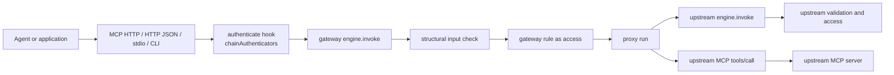

# Action Engine gateway

- Status: Proposal with a private proof of concept in
  [`packages/gateway`](../packages/gateway/). Not delivered behavior. Promote
  to an ADR before publishing the package or changing any normative contract.
- Date: 2026-11-07
- Applies to: a new `@invokta/gateway` package; no change to `@invokta/core`,
  `@invokta/mcp`, or `@invokta/http`

An **Action Engine gateway** publishes the capabilities of several Action
Engines and MCP servers through one endpoint and enforces the authentication
and authorization rules that the team operating the gateway configures.

This note answers three questions:

1. Can a gateway be built on the existing contracts without a second
   execution path?
2. Where do authentication, authorization, and upstream credentials belong?
3. Which accepted limits does a gateway touch, and what must an ADR decide
   before the package ships?

## Summary of the recommendation

**The gateway is a capability map, not a new runtime.** `createGateway`
turns explicitly configured upstreams into ordinary capabilities whose `run`
forwards to the upstream `engine.invoke` or MCP `tools/call`, and whose
`access` comes from the gateway's rules. The host passes that map to
`createEngine` and serves the resulting engine with the existing adapters:

```text
agent / app ──> MCP HTTP or HTTP JSON adapter ──authenticate──> gateway engine.invoke
                                                                  │ validate (structural)
                                                                  │ access = gateway rule
                                                                  └─ run ──┬─> upstream engine.invoke  (its own validation + access)
                                                                           └─> upstream MCP tools/call (service credential)
```

Consequences:

- **One execution path.** Every adapter still calls only `engine.invoke`
  (AE-ARCH-03). The gateway adds no adapter, transport, error code, event,
  context field, or pipeline stage.
- **Two enforcement points.** The gateway's rule runs as the capability's
  `access` stage; an upstream engine still runs its own `access` afterwards.
  The gateway can only narrow access, never widen it.
- **Everything composes.** `onEvent`, `@invokta/otel`, `applyMiddleware`
  (rate limits, quotas, caching), `@invokta/tooling`, the CLI, MCP stdio, the
  devtools, and the installer work on a gateway engine unchanged.

The proof of concept implements this design in about 1,200 lines of source
without changing an existing package.

## Evidence

The proposal follows the extraction rule of AE-SCOPE-04 and must meet it
before an ADR:

| Evidence | Where |
| --- | --- |
| Hosts already publish several engines behind one origin as a "Gateway" resource | ADRs [0039](./adr/0039-configurable-mcp-http-mount-path.md) and [0040](./adr/0040-installer-mounted-mcp-urls.md), issue #75 |
| Engines repeat the same authentication integration | ADR [0049](./adr/0049-jwt-bearer-authentication-helper.md): nine authentication examples |
| A plain-type MCP client facade already exists | `connectMcpClient` in `@invokta/mcp` |
| Consumers must install and authenticate every engine separately | `@invokta/installer` manages one entry per engine and client |

Still missing, and required before promotion: at least two real deployments
that aggregate upstreams they do not own, and a decision on the tensions
listed under [Relationship to accepted contracts](#relationship-to-accepted-contracts).

## Topologies

| Topology | What the consumer sees | Status |
| --- | --- | --- |
| **Aggregating** (fan-in) | One MCP server or HTTP API whose catalog combines namespaced capabilities from every upstream | Implemented by the proof of concept |
| **Mounting** (multiplexing) | One origin with one endpoint per engine, for example `/e/billing/mcp`, each with its own audience and Protected Resource Metadata | Possible today with ADR 0039 and 0042 handlers; a router helper is phase 3 |

Aggregation is the gateway proper: one installation, one credential, and one
policy for many engines. Mounting keeps one resource identifier per engine
and suits audience-bound OAuth tokens. Both are host compositions over the
same adapters.

## Architecture



### Request lifecycle

1. The adapter validates Host, Origin, route, method, and body bounds as it
   does today.
2. The adapter's `authenticate` hook returns a `Principal` or `null`.
   `chainAuthenticators` lets one gateway accept several methods, for example
   `@invokta/auth-jwt` for users and `apiKeyAuthenticator` for services.
3. `engine.invoke` resolves the gateway capability and runs the structural
   input check.
4. The capability's `access` is the gateway rule bound at construction. A
   throwing rule is a denial, never an execution failure. The decision is
   reported to `onDecision` without input, output, or credentials.
5. `run` forwards to the upstream with the caller's signal; for an engine
   upstream also the request ID, the mapped principal, and the progress sink.
6. The upstream result is returned; an upstream `DOMAIN_ERROR` is raised again
   as the same declared domain error, and every other failure keeps its public
   code or is normalized by the core.

## Configuration surface (proof of concept)

```ts
import { createEngine } from "@invokta/core";
import { serveMcpHttp, connectMcpClient } from "@invokta/mcp";
import { createJwtBearerAuthenticator } from "@invokta/auth-jwt";
import {
  apiKeyAuthenticator,
  chainAuthenticators,
  createGateway,
  engineUpstream,
  mcpUpstream,
  requireScopes,
} from "@invokta/gateway";

const gateway = createGateway({
  upstreams: [
    engineUpstream({ name: "support", engine: supportEngine }),
    await mcpUpstream({
      name: "docs",
      namespace: "kb",
      connection: await connectMcpClient(docsTarget),
      include: ["search", "fetch"],
      pin: process.env.DOCS_CATALOG_FINGERPRINT,
      timeoutMs: 10_000,
    }),
  ],
  rules: [
    { name: "no-deletes", match: "kb.delete", access: "deny" },
    { name: "kb-read", match: "kb.*", access: requireScopes("kb:read") },
    { name: "support", match: "support.*", access: "authenticated" },
  ],
  // defaultAccess: "deny" is the default.
  onDecision: (decision) => audit.write(decision),
});

const engine = createEngine({
  name: "acme-gateway",
  version: "1.0.0",
  capabilities: gateway.capabilities,
});

await serveMcpHttp(engine, {
  auth: {
    mode: "required",
    authenticate: chainAuthenticators(
      createJwtBearerAuthenticator(jwtOptions),
      apiKeyAuthenticator({ keys: serviceKeys }),
    ),
  },
});
```

| Export | Responsibility |
| --- | --- |
| `engineUpstream` | Snapshot an in-process engine's catalog through `list` and `describe`; forward to its `invoke` |
| `mcpUpstream` | Snapshot a connected MCP server's tools once, with bounded pagination and an optional pinned fingerprint; forward to `callTool` |
| `createGateway` | Bind each capability to its first matching rule; return the capability map and the route table |
| `chainAuthenticators` | Try several `authenticate` hooks in order |
| `apiKeyAuthenticator`, `hashApiKey` | Static service keys stored as SHA-256 digests |
| `requireScopes` | Access function over `principal.attributes.scopes`, the `@invokta/auth-jwt` default mapping |

## Authentication

Authentication stays where ADR 0007 put it: the HTTP adapters' required
`authenticate` hook, before `engine.invoke`. The gateway adds only
composition:

- `chainAuthenticators` returns the first non-null principal. A method that
  throws stops the chain, so an unavailable key set yields the adapter's
  sanitized 500 instead of a silent fallback to a weaker method.
- `apiKeyAuthenticator` accepts one header (default `x-api-key`), keeps only
  digests in configuration, bounds the presented key to 1,024 characters, and
  compares against every digest without an early exit.
- Local channels (stdio, CLI, direct) keep the host-supplied principal of
  AE-CLI-01 and AE-MCP-03.

The gateway does not issue tokens, perform login, or introspect tokens
(AE-LIMIT-04).

## Authorization

A rule is `{ name?, match, access }`. `match` is an exact capability ID,
`prefix.*`, or `*`. `access` is `public`, `authenticated`, `deny`, or a
function receiving `{ principal, input, context, route }`. Semantics:

- **First match wins**, in configuration order, like a firewall rule list.
  Binding happens once, at construction, and `gateway.routes` publishes which
  rule governs every capability so the policy can be reviewed and snapshot
  tested.
- **Deny by default.** Unmatched capabilities get `defaultAccess`, which is
  `deny` unless configured.
- **Fail closed.** A rule that throws or rejects denies and logs a
  payload-free warning; the outcome is reported as `failed`.
- **Strict configuration.** A rule or `include` pattern that matches nothing
  fails construction, so a typo cannot silently drop a deny rule.
- **Defense in depth.** An engine upstream still enforces its own `access`.
  `principal` on `engineUpstream` maps the gateway caller to the identity the
  upstream receives.

This is a routing table that assigns an access rule to each capability. The
decisions themselves remain functions or core access kinds; a rule may call a
PDP exactly as [capability authorization](./capability-authorization.md)
describes.

## Upstreams

### Engine upstream

- The catalog is read once from `list` and `describe`; `include` narrows it.
- Contracts are republished unchanged: title, description, schemas,
  annotations, deprecation, and declared domain errors.
- `run` calls the upstream `engine.invoke` with the gateway request ID,
  source, mapped principal, signal, and progress sink, so upstream validation,
  access, timeout, events, and progress all apply.
- The core never preserves a thrown `DOMAIN_ERROR`, so the gateway redeclares
  each upstream domain error and raises it again as a `CapabilityError`; the
  caller sees the same code, retry hint, and details.

### MCP upstream

- The host owns the MCP client connection, its credentials, and its lifetime.
  The gateway depends only on a structural `listTools`/`callTool` interface
  that `McpClientConnection` satisfies, so the package does not depend on the
  MCP SDK.
- Discovery runs once at the composition root: at most 64 pages and
  `maxTools` tools (default 256, at most 4,096). A duplicate tool name or an
  input or output schema without an object root fails startup.
- The gateway publishes `<namespace>.<tool>`; the namespace defaults to the
  upstream name.
- `fingerprint` is the SHA-256 of the canonical JSON of the published tools.
  With `pin`, any change to a tool's name, description, schemas, or
  annotations fails startup: a defense against MCP tool poisoning and silent
  description changes.
- Every tool call has a finite timeout (default 30,000 ms) and receives the
  invocation signal (AE-CONNECTOR-02).
- A tool with an output schema returns its `structuredContent`; one without
  returns `{ content }`. A tool error becomes the declared domain error
  `UPSTREAM_TOOL_ERROR` with the first text block, truncated to 1,024
  characters.

### Upstream credentials

The caller's credential is **never forwarded** to an upstream. Passing an
inbound token through creates a confused deputy and breaks audience binding;
the MCP authorization specification forbids it. In the proof of concept each
MCP upstream uses one service credential held by the host. Per-caller
upstream credentials, through token exchange or a connector broker, are
phase 4 and reuse the `CredentialSource` port of
[connector brokers](./connector-brokers.md).

## Security model

| Threat | Control in the proof of concept |
| --- | --- |
| Anonymous access to a protected upstream | Adapter `authenticate` is required; default rule is `deny` |
| A typo removes a deny rule | Rules and include patterns must match at least one capability |
| An unavailable PDP grants access | Throwing or rejecting rules deny (`failed` outcome) |
| The gateway widens an upstream's policy | Upstream engines still enforce their own `access` |
| Tool poisoning or a silent catalog change | Catalog frozen at startup; optional pinned fingerprint |
| Confused deputy through token passthrough | Caller credentials never reach upstreams; service credentials per connection |
| An upstream hangs or floods | Finite tool timeout, bounded discovery, truncated error messages; the core enforces the lossless JSON model |
| Audit leaks payloads or secrets | `onDecision` carries IDs, rule name, and outcome only; failures in the sink are contained |
| Static key disclosure from configuration | Only SHA-256 digests are configured |

## Relationship to accepted contracts

| Contract | Proof of concept | Decision needed |
| --- | --- | --- |
| AE-ARCH-03 single path | Respected: adapters call only `engine.invoke`; proxies call upstream `engine.invoke` or `tools/call` | None |
| AE-ARCH-04 portability | Uses only Web globals (`crypto.subtle`, `structuredClone`) | Add the package to the portability test when promoted |
| AE-SCHEMA-02, AE-INV-02 validation | **Tension**: the gateway checks only that input and output are JSON objects; the upstream validates | Phase 1 adds a host-injected JSON Schema validator port |
| AE-LIMIT-02 no remote registry or discovery | **Tension**: MCP tools are listed over the network once, at the composition root, explicitly configured, and optionally pinned | Accept startup discovery as explicit composition, or require a committed catalog lock file |
| AE-LIMIT-04, scope matrix: no policy language | **Tension**: rules are a first-match routing table over capability IDs; decisions stay functions | Accept the routing table as configuration rather than a policy language |
| AE-SCOPE-01 package inventory | A fourteenth package, private for now | An ADR adds `@invokta/gateway` as an optional runtime helper |
| AE-INV-01 capability first; "a server that merely mirrors APIs is not an Action Engine" | The gateway is infrastructure, not an Action Engine; it republishes upstream domain IDs under a namespace | Document the gateway as a host composition, never as a domain engine |
| Maturity level E, federated platform | Out of scope: no registry, tenancy, rollout, control plane, or dynamic catalog | Keep explicit in the ADR |
| AE-OBS-01 single hook | `onDecision` is a gateway option, not an engine hook; engine events are unchanged | Decide whether decisions stay a gateway option or become an `onEvent` recipe |
| AE-ACCESS-01 published access kind | Every gateway capability publishes `access: "function"` | Accept, or publish the bound kind when the rule is `public` or `authenticated` |

## Known limitations found by the proof of concept

- **Input errors from MCP upstreams arrive as `UPSTREAM_TOOL_ERROR`.** The
  demo shows an upstream Invokta engine's `INPUT_INVALID` wrapped as a domain
  error with the serialized upstream error as its message. The validator port
  of phase 1 rejects invalid input before the call, as `INPUT_INVALID`.
- **Rules that read `input` see unvalidated data.** Until the validator port
  exists, a rule must treat `input` as untrusted.
- **The catalog is not filtered per caller.** `engine.list()` has no principal,
  so every authenticated caller sees every published tool, including ones it
  cannot call. Per-principal listing needs an adapter decision.
- **Rich MCP content is not reconstructed.** A proxied tool without an output
  schema returns `{ content }` as structured data; images and audio are not
  re-emitted as content blocks.
- **No upstream lifecycle.** A dropped stdio or HTTP connection fails calls
  with `EXECUTION_FAILED` until the host reconnects and restarts.
- **Request IDs are shared with engine upstreams** for correlation. Hosts
  that attach one `@invokta/otel` handler to both the gateway and an upstream
  engine must use separate handlers.

## Limits (proof of concept)

| Dimension | Limit |
| --- | --- |
| Upstream name and namespace | 1-64 lowercase letters, digits, or inner hyphens |
| Rule pattern | `*`, an exact ID, or `prefix.*` |
| MCP tools per upstream | 256 by default, at most 4,096 |
| MCP `tools/list` pages per upstream | 64 |
| MCP tool call timeout | 30,000 ms by default; 1 through 2,147,483,647 ms |
| Upstream tool error message | 1,024 characters |
| Presented API key | 1,024 characters |

## Delivery plan

Each phase is one cohesive, test-first deliverable with its own acceptance
criterion.

| Phase | Deliverable | Acceptance criterion |
| --- | --- | --- |
| 0 — Proof of concept | Private `packages/gateway`, tests, runnable demo, this note | Engine and MCP upstreams are served through MCP HTTP and HTTP JSON with chained authentication, first-match rules, default deny, decision audit, and pinned MCP catalogs; repository gates pass |
| 1 — Contract hardening | JSON Schema validator port injected by the host; ADR; package public API types test; architecture and portability tests; recipe and docs-site reference | Invalid input to any upstream fails as `INPUT_INVALID` before `run`; the ADR resolves every tension above |
| 2 — Catalog lock | `invokta gateway lock` in `@invokta/tooling`: write the MCP catalog snapshot and fingerprints to a committed file; the gateway verifies it at startup | A changed upstream tool fails startup and `yarn check` with a reviewable diff |
| 3 — Mounting router | Web-standard router that serves several MCP and HTTP handlers, each with its own mount path, authenticator, and Protected Resource Metadata | One origin serves `/e/<engine>/mcp` per engine and passes the installer's mounted-URL tests |
| 4 — Delegated credentials | Per-principal upstream credentials through the connector-broker `CredentialSource` port, including RFC 8693 token exchange | A user-subject upstream call receives a credential minted for that user and audience; a missing grant is a declared domain error |
| 5 — Operations | Recipes, not framework features: rate limits and quotas with `applyMiddleware`, upstream health and reconnection owned by the host, OpenTelemetry correlation across gateway and upstream engines | Each recipe is backed by an executable test |

Publishing `@invokta/gateway` requires phases 1 and 2 and an accepted ADR.

## Open decisions

1. Is startup tool discovery acceptable, or must MCP catalogs always come from
   a committed lock file (phase 2)?
2. Should rules also match on upstream name or annotations, for example "deny
   every `destructive` capability unless the caller has `admin`"? The current
   design keeps one dimension, the capability ID, and leaves the rest to
   functions.
3. Should the MCP adapter gain per-principal tool listing, or should hosts run
   one gateway engine per audience?
4. Should an upstream Invokta engine's structured MCP error (`INPUT_INVALID`,
   `FORBIDDEN`) be mapped back to the same framework code, accepting that an
   upstream could choose the code the gateway reports?
5. Does the gateway ship as an optional runtime helper next to `auth-jwt` and
   `otel`, or as an official example until the evidence threshold is met?

## Proof-of-concept validation

- `yarn vitest run packages/gateway`: 39 tests covering engine and MCP
  upstreams, rule semantics, defaults, fail-closed rules, audit, domain error
  republication, progress, cancellation, timeouts, pinning, bounds,
  authentication methods, and an end-to-end path from an MCP client through
  the gateway to an authenticated upstream MCP server.
- `node packages/gateway/demo/serve.mjs` after `yarn build`: starts an
  upstream MCP engine that only the gateway's service token can reach and the
  gateway over MCP HTTP and HTTP JSON. Observed: 401 without a key, 403 for a
  missing scope or a deny-by-default capability, 422 for a republished domain
  error, 200 for allowed calls, 401 when calling the upstream directly without
  the service token, and one audit line per decision.
