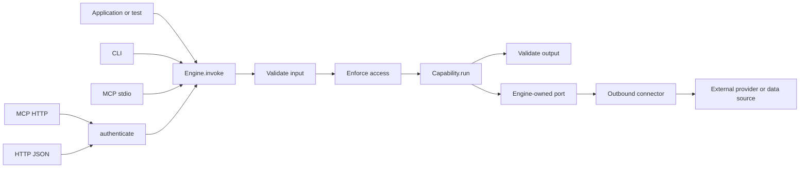

# Architecture and contracts

## Single hexagon

**AE-ARCH-01 — Direction.** The core MUST NOT import the CLI, MCP, HTTP, a model
SDK, or an identity SDK. Inbound adapters import only the core's public API.
Capabilities MAY import interfaces and rules from the custom engine.

**AE-ARCH-02 — Simple injection.** Repository, model, data, and tool interfaces
belong to the custom engine. Implementations enter through a factory or closure
at the composition root. An outbound connector is a provider- or
technology-specific implementation of one or more of those engine-owned ports.
Capabilities receive only the ports they use; provider clients, credentials,
and connector registries MUST NOT enter capability contracts or
`ExecutionContext`. The framework MUST NOT register ports or provide a connector
catalog, service container, lifecycle, or formal modules. ADR 0036 defines this
authoring boundary.

**AE-ARCH-03 — Single path.** No inbound adapter MAY call `run` or an outbound
connector directly. All inbound adapters use `engine.invoke`. Authentication
produces a `Principal`; authorization remains inside `invoke`.

**AE-ARCH-04 — Runtime portability.** The core MUST NOT import a Node.js
built-in module; it uses only ECMAScript and Web platform globals, and an
architecture test enforces the import rule. The core reads `util.types` once
through `process.getBuiltinModule` where the host provides it (Node.js, Deno,
Bun) to recognize proxies and promises without running user code. A process
that identifies as Node.js but cannot resolve it MUST fail to load the core.
Other hosts use the documented fallback of ADR 0042: JSON values still reject
proxies through structured cloning, while other defensive boundaries may
invoke proxy traps. `@invokta/mcp/web` and the `@invokta/http` package root
MUST NOT load a Node.js built-in module. Node.js is
the runtime verified by tests; Fetch runtimes are supported by design.

## Outbound connectors

**AE-CONNECTOR-01 — Construction.** A custom engine owns each outbound port and
explicitly injects its connector implementation at the composition root.
An engine MAY use `defineConnector` to capture a non-empty internal name, a
Standard Schema configuration contract, opaque dependencies, and a synchronous
factory for one or more named ports. Definition performs no validation or
factory call. Creation MUST validate and snapshot a lossless JSON configuration
object before the connector callback runs. Connector-specific validation still
MUST cover required configuration, provider-appropriate endpoints and credential
placement, and finite safe-integer limits within their documented ranges.
Importing, defining, or constructing a connector MUST NOT perform external I/O.

**AE-CONNECTOR-02 — Invocation.** Every connector operation that may wait MUST
accept and propagate the invocation signal and stop connector-owned waits when
it is aborted. Connector work performed during `access` MUST have its own finite
client or operation deadline because capability timeout begins after
authorization. Every capability that invokes a connector during `run` MUST set
a finite `timeoutMs`. Polling, pagination, batches, response sizes, concurrency,
fan-out, and opt-in retries MUST have explicit finite bounds where applicable.

**AE-CONNECTOR-03 — Translation and failure.** A connector MUST validate
external responses and return port-owned domain values rather than raw provider
payloads. It MUST preserve observed cancellation and sanitize provider failures,
including internal causes, so credentials and unfiltered payloads do not enter
public errors, diagnostics, events, logs, or snapshots. Connectors add no error
code or execution path; ADR 0036 defines the complete authoring boundary.
ADR 0037 defines the optional typed construction helper.

## Normative pipeline

**AE-PIPE-01 — Order.** `engine.invoke` MUST:

1. generate or accept a `requestId`;
2. resolve the capability by ID;
3. validate and transform the input;
4. create the `ExecutionContext` and enforce `access`;
5. combine the received `AbortSignal` with `timeoutMs`, execute `run`, and validate
   the output;
6. emit success or failure and return the typed data or throw an `EngineError`.

This pipeline has no port registry, concurrency slot, queue,
before/after/onError policies, obligations, retry, fallback, cache, or model
routing. Those decisions belong to the capability or its injected dependencies.
Middleware composed into a capability's `run` (AE-MIDDLEWARE-01) is part of
the capability, not a pipeline policy.

Input and output validation includes checking the value produced by the Standard
Schema transformation against the lossless JSON data model in ADR 0002. A value
outside that model fails in the same validation stage, before `access` for input
or before return for output. The corresponding code is `INPUT_INVALID` or
`OUTPUT_INVALID`; public details identify the contract failure without including
the rejected value. A successful input transformation is deep-snapshotted for
the request before authorization. `access` receives an independent clone and
`run` receives the request-owned execution snapshot, so neither caller mutation
nor authorization mutation changes the data that execution observes.

`createEngine` is also the capability-contract boundary. It MUST capture every
top-level capability field exactly once at construction so later replacement or
changing accessors for `input`, `output`, `access`, `run`, metadata, annotations,
declared domain errors, deprecation, or timeout configuration cannot create a
split registered contract. The same captured `timeoutMs` value is validated,
described, and used for execution.
Standard JSON Schema converters run synchronously during construction. Their
documents MUST be object-rooted lossless JSON, copied away from converter-owned
objects, and deeply frozen internally. Cyclic, proxy-backed, accessor-backed, or
otherwise non-JSON documents fail construction synchronously. `list` and
`describe` return
fresh, deeply frozen snapshots, preventing a caller or adapter request from
changing later runtime or MCP contracts. `describe` also publishes the kind of
the access rule as `access`: `public`, `authenticated`, or `function`; a
function rule itself is never exposed. Standard Schema validation itself
continues to run only at invocation through the captured input and output schema
objects.

When present, `timeoutMs` MUST be an integer from `1` through `2_147_483_647`,
inclusive. `createEngine` validates this limit synchronously. Zero, negative or
fractional values, non-finite numbers, and values above the limit fail
construction with `TypeError`; they never reach the host timer implementation.

## Capability middleware

**AE-MIDDLEWARE-01 — Composition, not a pipeline stage.**
`applyMiddleware(capabilities, ...middleware)` MAY wrap the `run` of every
capability in an explicit map before `createEngine`. It is pure, eager, and
synchronous. It returns a new frozen map with the same keys. Each capability
is copied with its own properties and its possibly inherited contract fields
kept by identity, and only `run` is replaced. It registers nothing and invokes no middleware,
access rule, or handler. The chain therefore executes
inside stage 5: input validation and `access` complete before the first
middleware, the capability timeout and caller cancellation cover the whole
chain through `context.signal`, the outermost result is validated against the
output schema, and middleware failures are normalized exactly like `run`
failures. That includes a `CapabilityError`, which becomes `DOMAIN_ERROR` only
when the wrapped capability declares its code. A middleware receives:

- the map key as `capabilityId`;
- a lazily taken, deep-frozen input snapshot shared by the invocation's
  middleware;
- the unchanged `ExecutionContext`, whose principal it MUST NOT mutate; and
- an argument-free `next()`.

The first listed middleware is outermost. `next()` may start the next layer at
most once, only while its middleware is pending and the signal is not aborted;
other calls reject with `TypeError` or the abort reason. A started layer
settles before its caller's result is returned, so no layer outlives the
invocation. A composed map keeps its composition provenance; a plain map never
gains it. ADR 0051 defines the complete boundary.

## Errors

**AE-ERR-01 — Taxonomy.** `EngineError` MUST use one of these codes:

- `CAPABILITY_NOT_FOUND`;
- `INPUT_INVALID`;
- `UNAUTHENTICATED`;
- `FORBIDDEN`;
- `OUTPUT_INVALID`;
- `CANCELLED`;
- `EXECUTION_FAILED`;
- `DOMAIN_ERROR`.

Unknown errors become `EXECUTION_FAILED`. Only `publicDetails` may be serialized;
`cause` and the stack remain internal. Cancellation or a timeout observed by the
runtime becomes `CANCELLED`. A thrown `EngineError` is preserved only when its
own `code` and `message` data properties form a stable public error. A proxy,
accessor-backed property, missing message, or code outside the first seven codes
of the taxonomy is treated as an unknown error without invoking the unsafe
property; proxy recognition depends on host introspection (AE-ARCH-04).

**AE-ERR-02 — Declared domain errors.** Only the runtime issues `DOMAIN_ERROR`.
When `run` rejects with a `CapabilityError` created by the core's constructor,
its constructor-time code must be declared in the capability's `errors` field
and its details must pass the declared schema, as a lossless JSON object, within
the capability timeout and cancellation race. The resulting error has the
declared description as its message and `publicDetails` of
`{ code, retryable, details? }` with the domain code, the declared retry hint,
and the validated frozen details. An undeclared code, missing, unexpected, or
invalid details, and a look-alike, prototype-forged, or proxied error become
`EXECUTION_FAILED` with the original kept as the internal cause. Cancellation
observed by the runtime keeps precedence. A thrown `EngineError` with code
`DOMAIN_ERROR`, including one issued by another invocation, is never preserved,
and a `CapabilityError` raised outside `run` is never a domain error; it is
normalized like any other access-rule or validator failure. ADR 0045
defines the declaration limits.

Reading `requestId`, `source`, and `onProgress` from invocation options is part
of this error boundary. If any of these property accesses throws, or
`onProgress` is present but is not a function, the runtime discards all
partially read option metadata, uses a generated request ID and the default
`direct` source, emits the ordered started and failed events, and throws a
normalized `EXECUTION_FAILED` error. The property failure remains internal as
the cause.
Failures while reading or snapshotting `principal` are a distinct identity
boundary and always produce a sanitized `UNAUTHENTICATED` error. Failures while
reading `signal` or setting up caller-signal state always produce a sanitized
`EXECUTION_FAILED` error. An `EngineError` thrown by either caller-controlled
boundary cannot select its public code, message, or details. `InvokeOptions.signal`
must be a platform-branded `AbortSignal` from the supported runtime. Where the
host provides trap-free introspection (AE-ARCH-04), the runtime rejects proxies
without invoking their traps; it then checks the platform brand with a captured
intrinsic before it invokes any signal method. Structural, polyfilled,
or proxy substitutes fail as `EXECUTION_FAILED` without executing their accessors,
traps, or listener methods. Without that introspection, a forwarding proxy may
pass a brand check that reads properties through `[[Get]]`, and its traps run. Captured platform intrinsics also bypass hostile
own-property overrides. Authorization receives a runtime-owned, no-timeout signal
view, while execution retains the caller signal identity when no timeout is
configured. The capability timeout still starts only after authorization
completes.

## Events

**AE-OBS-01 — Single hook.** The only cross-cutting hook is `onEvent`,
with the events `invocation.started`, `invocation.completed`, and
`invocation.failed`. The started event contains `requestId`, `capabilityId`,
`source`, optional `principalId`, and ISO `startedAt`. The completed event contains
`requestId`, `capabilityId`, and `durationMs`. The failed event contains those
identifiers, `durationMs`, an `EngineErrorCode`, and, only for `DOMAIN_ERROR`,
the declared `domainCode`; domain error details are never included. Payloads, tokens, and
credentials are not included by default. A rejected or thrown `onEvent` hook
MUST NOT change the invocation result; the runtime MAY send a payload-free
diagnostic to the configured logger. The runtime invokes the started hook and
then exactly one terminal hook synchronously in pipeline order, but it observes
any promise returned by a hook without awaiting it. Event delivery is therefore
best-effort: a pending hook cannot block execution or result delivery, and the
framework provides no delivery-completion guarantee. Rejections from the hook and from an
asynchronous diagnostic logger are contained without producing an unhandled
rejection. After successful output validation, the runtime MUST clear its
capability timeout before invoking the completed hook.
Capability middleware (AE-MIDDLEWARE-01) is composed into a capability's `run`
before engine construction; it is not an engine hook and does not change this
event stream.

**AE-OBS-02 — OpenTelemetry instrumentation.** `@invokta/otel` provides
`createOpenTelemetryEventHandler`, an `onEvent` hook built only on the
OpenTelemetry API peer. It MUST NOT add an OpenTelemetry dependency to the core
or another package, MUST NOT throw into the engine, and MUST treat error codes
and sources as opaque strings. It starts one `INTERNAL` span named
`invoke {capabilityId}` at the event's `startedAt` in the active context,
correlates the terminal event by `requestId`, and ends the span after
`durationMs` with an error status and code on failure, plus the declared
`domainCode` of a `DOMAIN_ERROR`. It records the
`invokta.invocations` and `invokta.invocation.failures` counters and the
`invokta.invocation.duration` histogram with bounded attributes. Principal IDs
are recorded only on explicit opt-in and never on metrics. Pending spans are
capped and the oldest is evicted. Spans and `contextFor` are accurate only while
request IDs are unique among concurrent invocations; when a running
invocation's request ID is reused, the handler MUST NOT assign an outcome
across the overlapping invocations within the `maxPendingSpans` bound. The invocation span is not active inside
`access` or `run`; a capability nests its own spans through the injected
`contextFor(requestId)` accessor. ADR 0050 defines the attribute names,
metric units, and limits.

## Progress

**AE-PROGRESS-01 — Advisory progress.** `ExecutionContext.reportProgress`
accepts `{ progress, total?, message? }` and delivers a fresh, frozen snapshot
synchronously to the invocation's optional `InvokeOptions.onProgress` sink. A
report is delivered only when `progress` is finite, at least zero, and greater
than the last delivered value; `total`, when present, is finite and positive;
and `message`, when present, is a string of at most 1,024 UTF-16 code units.
Negative zero is delivered as `0`. Invalid, proxy, non-increasing, and late
reports are dropped. The reporter never throws, returns nothing, and is a no-op
without a sink. Delivery is active only while `run` is pending: an access rule
receives a no-op reporter, and delivery stops when `run` settles or the
invocation signal aborts. A sink's synchronous throw or rejected promise is
contained, a returned promise is never awaited, and the first sink failure of
an invocation sends one payload-free `Invocation progress callback failed.`
diagnostic with only the `requestId` to the logger. Progress adds no engine
event, pipeline stage, error code, or cross-cutting hook.

MCP forwards delivered reports as `notifications/progress` only for a
`tools/call` request whose `_meta.progressToken` is a string of at most 256
UTF-16 code units or a safe integer, echoing that token exactly. The adapter
sends at most one notification per 100 milliseconds per request, only after the
previous one has been written and while the response channel reports capacity.
It holds at most one report, the latest, delivers it just before a successful
result, and drops it when the call fails or is cancelled; send failures never
change the tool result. The CLI passes a
sink only in the `human` format and writes progress to stderr. The plain HTTP
adapter (`AE-HTTP-01`) answers with one JSON body and passes no sink, so its
callers receive no progress. ADR 0043 defines the complete boundary.

## CLI

**AE-CLI-01 — Commands.** `@invokta/cli` MUST implement `list`, `describe`,
`run`, and `help`, accept JSON through `--input` or stdin, and receive the local
principal through the composition root. It MUST NOT provide an actor, role, or
login flag; schema-derived flags populate business input only.

**AE-CLI-02 — I/O.** `stdout` contains only the requested result; logs and
diagnostics go to `stderr`. The exit code is `0` for success, `1` for an execution
or authorization failure, including a declared domain error, and `2` for invalid
usage or JSON. `runCli` returns the
exit code and does not terminate the process or mutate `process.exitCode`; the
composition root owns that process-level decision. Errors are compact JSON with
only `code`, `message`, and optional `publicDetails`. JSON is the default output
format; trusted configuration may select deterministic, pretty-printed JSON as
the human rendering of the same result. Only the `human` format observes
progress: it writes each delivered report as one
`progress <progress>[/<total>][: <message>]` line to `stderr` without awaiting
the write, escaping Unicode control, format, line-separator, and
paragraph-separator characters in the message.
Invokta does not impose a stdin size
limit; hosts that accept untrusted local input must bound the stream before it
reaches the adapter.

The default stdin reader MUST decode byte chunks incrementally with fatal UTF-8
validation. It MUST preserve a valid multibyte code point split across byte
chunks and a surrogate pair split across string chunks. Malformed UTF-8 produces
an `INVALID_USAGE` diagnostic and exit code `2` without calling `engine.invoke`.

`CliIo.writeStdout` and `CliIo.writeStderr` accept either `void` or
`Promise<void>`, and `runCli` MUST await both kinds of writer. A stdout writer
that throws or rejects produces the sanitized `EXECUTION_FAILED` diagnostic and
exit code `1`. A stderr writer that throws or rejects is contained; it MUST NOT
create an unhandled rejection or prevent `runCli` from resolving the numeric code
selected for the original outcome.

**AE-CLI-03 — Schema-derived flags.** `run` accepts exactly one input source:
`--input <json>`, `--stdin`, or flags derived from the top-level properties of
the capability's published input schema. Combined sources are invalid usage.
Flags cover `string`, `number`, `integer`, and `boolean` properties, `enum` and
`const` values of one such type, and arrays of them through repeated flags.
Property names map deterministically to kebab-case spellings; reserved names
(`input`, `stdin`, `help`, `format`) and colliding spellings fail closed for
every property involved. Nested objects, undecidable unions, and other schemas
are input-only and MUST be supplied through `--input` or `--stdin`. Flag parsing
only decodes values by their declared type: it MUST NOT check required
properties, apply defaults, or enforce constraints, and the resulting object
MUST go through `engine.invoke`. Unknown flags, undecodable values, duplicates,
and flags for input-only properties are invalid usage and never echo values.
`--input` and `--stdin` do not read the capability description. See ADR 0047.

**AE-CLI-04 — Help.** `help` and `--help` print the general usage;
`help <capability-id>` and `run <capability-id> --help` print a deterministic,
bounded, sanitized text page with the capability's title, description,
annotations, flags, required markers, allowed values, declared defaults, and
input-only properties. Help is written to stdout with exit code `0`, ignores the
`format` option, and never invokes a capability. Shell completion is not
provided.

## MCP

**AE-MCP-01 — One capability, one tool.** Title, description, schemas, and
annotations map directly to the tool. The capability key maps deterministically
to a portable tool name matching `^[a-zA-Z0-9_-]{1,64}$`, and `tools/call`
resolves that name back to the original key before `engine.invoke`. The adapter
MUST fail closed if two keys map to the same tool name. A deprecated capability
keeps its tool; its description starts with the deprecation notice and the same
notice is published as `_meta["dev.invokta/deprecated"]` (AE-EVOLVE-01).
Success returns
`structuredContent` and a JSON text fallback. A nonexistent tool, including one
hidden by visibility (AE-VIS-01), is a protocol
error; all other capability errors return `isError: true`. Error serialization
is atomic: if the adapter cannot safely read or serialize the structured
`EngineError`, it MUST return the generic `EXECUTION_FAILED` tool error and MUST
NOT let the SDK convert the failure into an internal protocol error. A
`DOMAIN_ERROR` is a capability error whose `publicDetails` carry the domain
code, retry hint, and validated details. Generated
profiles that include MCP MUST run the same catalog construction as a build-time
preflight from their canonical check, without starting an adapter or invoking a
capability.

Rich tool result content is derived from the output contract (ADR 0044). While
building the catalog shared by stdio and HTTP, the adapter plans each tool from
the top-level properties of its output JSON Schema, directly or as array items:
a base64 string whose `contentMediaType` is an allowlisted image or audio type,
a media object with an enumerated allowlisted `mimeType` and one base64
property, or a resource-link object whose `uri` declares
`contentMediaType: "text/uri-list"` and that has a string `name`. A shape
without a content keyword never opts in. Each valid value whose block type the
request's protocol revision defines becomes an `image`, `audio`, or
`resource_link` block after the JSON text block; an invalid or unsupported
value only stays in the text block. `structuredContent` MUST remain the
complete validated output, and the text block MUST keep its structure,
replacing each base64 value a block carries with a placeholder naming that
block. A result with more than 16 planned values, or without any block, MUST be
the unchanged structured result and full JSON text fallback, so a capability
without a recognized form is presented byte for byte as before. The catalog
preflight reports close-but-unsupported content annotations as warnings
without failing; the core and its contracts gain no MCP concept.

**AE-MCP-02 — Isolated SDK.** `@invokta/mcp` encapsulates the official SDK and
MUST NOT leak its types through the public API or copy it into the core. The
baseline revision is `2025-11-25`; the approved version is recorded in ADR 0006
and the lockfile. Valid request IDs retain their protocol identity, including
numeric zero and the empty string, and cancellation MUST reach only the request
identified by the notification.

**AE-MCP-03 — stdio.** `stdout` is reserved exclusively for the protocol; logs go
to `stderr`. The trusted local principal is configured by the host. The signal
provided by the SDK MUST be propagated to `context.signal`. The stdio server owns
the protocol connection lifetime: stdin end or close MUST idempotently close the
transport, abort active request signals, and remove its stream listeners. A
broken stdout pipe is a normal client disconnect and MUST be contained without an
uncaught error or diagnostic on protocol stdout. On
POSIX, where Node performs pipe writes asynchronously, channel teardown MUST
discard and settle pending protocol writes before error containment is removed,
so a backpressured or late-failing write cannot keep the process alive or escape
as an uncaught stream error.

The stdio read buffer defaults to 10,485,760 bytes. A host MAY configure
`maxReadBufferBytes` to another positive safe integer. A buffer append that keeps
the total at or below the configured boundary is accepted. An append that would
cross the boundary closes the protocol connection, aborts active request
signals, removes the adapter's process-stream listeners, and rejects
`serveMcpStdio` with a payload-free error. An invalid limit rejects before the
transport installs process-stream listeners.

[Node performs pipe writes synchronously on Windows](https://nodejs.org/api/process.html#a-note-on-process-io).
Normal stdio protocol exchanges remain supported there, but a peer that stops
draining stdout can block JavaScript before EOF handlers run. Windows
integrations MUST continuously drain server stdout and MUST provide process
supervision capable of terminating a stalled process. The adapter does not claim
interruptible teardown for a non-reading Windows peer.

**AE-MCP-04 — Stateless HTTP.** The sole protocol endpoint is the configured
mount path, `/mcp` by default; each request is independent. The default bind address is `127.0.0.1`. `Host` and `Origin` MUST be
validated. Unauthenticated mode requires an explicit development option whose
name communicates the risk.

One protocol implementation enforces this boundary for two host adapters
(ADR 0042): `serveMcpHttp` owns a `node:http` listener, and
`createMcpHttpHandler`, also exported by the portable `@invokta/mcp/web` entry
point, serves a Fetch `Request` and returns a `Response`. The rules below apply
to both. A Fetch host cannot reveal repeated raw header fields or an
unnormalized request target, so the handler requires every authority it can
observe, the `Host` header and the URL authority, to be allowed; it defaults to
the loopback host names; it treats any comma in `Host`, and a comma outside a
quoted string in `Content-Type`, as a repeated field; and it routes the host's
normalized path, still rejecting a query, a fragment, and percent encoding. A
merged `Authorization` value reaches the authenticator as one value. The
handler cancels the request body stream when it stops reading, including when
`request.signal` aborts, sets no hop-by-hop header, and leaves connections and
shutdown to the host; `request.signal` is the request cancellation signal.

The protocol endpoint accepts only `POST`. Each accepted POST creates a new MCP
server and a new transport with sessions, resumption, event storage, and
server-to-client SSE disabled. Every response is one JSON body, except that a
`tools/call` request carrying a usable progress token (`AE-PROGRESS-01`)
receives a `text/event-stream` response for that request only, from both
`serveMcpHttp` and `createMcpHttpHandler`. That stream carries the request's
progress notifications followed by its JSON-RPC response, closes after the
response, and has no event ID, priming event, resumption, or connection-scoped
header. The boundary relays it through a queue of at most one chunk and offers
the next progress notification only while that queue is empty, so a consumer
that stops reading leaves at most one queued notification and one held report
per request; cancelling the stream aborts the invocation. The Node.js adapter
reads the next chunk only after the socket has taken the previous one and
applies Node.js connection rules, including a client's `Connection: close`.
When OAuth Protected Resource Metadata is
configured, its public well-known GET route is the only non-protocol route.
Only the exact, canonical mount path reaches protocol dispatch; dot segments,
percent encoding, a query, a fragment, and absolute-form targets are rejected.
A configured mount path is validated before listening: an absolute path of
unreserved ASCII segments, at most 256 bytes, without a dot segment, an empty
segment, percent encoding, a query, a fragment, or a trailing slash, whose final
segment is `mcp` (ADR 0039). The `2025-11-25` profile accepts exactly one top-level JSON-RPC message
and rejects every top-level array before SDK dispatch. `Accept` must contain the
exact `application/json` and `text/event-stream` media ranges with positive
quality. After successful authentication, exactly one raw `Content-Type` header
is required and it must identify the exact `application/json` media type;
missing, duplicated, or invalid values return HTTP 415.
`Host` is validated for every request before authentication. An `Origin` header
is optional, but any supplied origin requires an explicit exact allowlist.
Boundary failures for `Host` or `Origin` return HTTP 403. A capability-level
`FORBIDDEN` remains an MCP tool execution error over HTTP 200.

After Host, Origin, and canonical route validation, an invalid method or a
declared body overflow is rejected before the authentication hook. Any response
that terminates without consuming the request body advertises connection closure,
drains available data, and closes an incomplete request after flushing the
response. Body reading checks the aborted and destroyed state both before and
after listener installation so a disconnect race always settles.

Exactly one raw `Host` header is required, an IPv6 authority must use brackets,
and forwarded-host headers are ignored.
The authentication hook receives only the normalized path, method, cancellation
signal, and a read-only header view with `get` and `has`. Request bodies default
to a 1,048,576-byte limit. A host may configure `maxRequestBodyBytes` to another
positive safe integer. Both an oversized `Content-Length` and a body that crosses
the limit while streaming return HTTP 413 before protocol dispatch.

An authenticator returns a `Principal` for valid credentials or `null` for
missing or invalid credentials; `null` produces HTTP 401. A thrown authenticator
error is treated as an infrastructure failure and produces a sanitized HTTP 500.
The adapter validates and snapshots the authentication mode and hook before it
listens. After each successful hook call, it deep-clones and validates the
request's `Principal`; the ID must be a nonempty string and optional attributes
must be a record. Malformed, non-cloneable, or subsequently mutated identities
cannot reach `invoke`. More than one raw `Authorization` header is rejected
before authentication.
Request bodies are decoded incrementally as strict UTF-8 while enforcing the byte
limit. An incomplete, overlong, or otherwise malformed byte sequence produces a
sanitized HTTP 400 JSON-RPC parse error before SDK dispatch or `invoke`; valid
multibyte sequences may span incoming chunks.
The adapter propagates cancellation when the active HTTP request disconnects.
Cross-request MCP cancellation is not promised by the stateless profile because
no transport or session survives between requests.

Protected Resource Metadata requires an HTTP(S) resource whose path is exactly
the configured mount path, without credentials, query, or fragment; its document
is served at the RFC 9728 path-suffix location. HTTPS is mandatory except for an
explicit loopback HTTP development resource. At least one authorization server
is required; each authorization server uses HTTPS without credentials, query, or
fragment. Authorization-server paths are allowed because OAuth issuer identifiers
may use path components.

## Plain HTTP JSON

**AE-HTTP-01 — Web-standard handler.** `@invokta/http` exports
`createHttpHandler(engine, options)`, a `(request: Request) => Promise<Response>`
handler whose package-root modules import no Node.js built-in module
(AE-ARCH-04), and
`createHttpOpenApiDocument(engine, options?)`. Relative to a validated
`basePath` (default `/`), `GET /capabilities` returns `{ capabilities }` from
`engine.list()`, `GET /capabilities/{id}` returns `engine.describe(id)`,
`POST /capabilities/{id}` returns the output of `engine.invoke(id, body)` with
source `http`, and `GET /openapi.json` returns the generated document. `{id}`
is one percent-encoded segment decoded once; construction rejects the
unreachable keys `.` and `..`. The handler validates and snapshots its
configuration and capability IDs at construction and never rejects. The
optional `@invokta/http/node` subpath serves the same handler on `node:http`
without adding routes, limits, or statuses, and rejects a duplicated `Host` or
`Authorization` header and every request target that URL normalization would
change, including dot-segment aliases (ADR 0048).

**AE-HTTP-02 — Boundary.** Each request is checked in order: host allowlist
(loopback names by default), `Origin` (rejected unless CORS lists it exactly),
route, CORS preflight, method (405 with `Allow`), declared body size (413),
authentication, capability ID (an ID outside the captured catalog, or hidden
from the principal by visibility (AE-VIS-01), is 404 `CAPABILITY_NOT_FOUND`
without reaching `engine.invoke`, emitting an event, or reading the body), `application/json` content type (415), streamed strict UTF-8
body within the limit (default 1,048,576 bytes; 413), and JSON parsing
(400 `INVALID_JSON`). `auth` is required and uses the same required or
`dangerously-disabled-for-development` modes and the same structural
`{ path, method, headers, signal }` request as MCP HTTP; required mode protects
every route, including the OpenAPI document. `null` or a malformed principal is
401 with `WWW-Authenticate: Bearer`; a thrown authenticator is a sanitized 500.
`request.signal` reaches the authenticator and `engine.invoke`.

**AE-HTTP-03 — Errors and export.** Every error body is
`{ error: { code, message, publicDetails? } }` without causes or stacks.
`INPUT_INVALID` is 400, `UNAUTHENTICATED` 401, `FORBIDDEN` 403,
`CAPABILITY_NOT_FOUND` 404, `DOMAIN_ERROR` 422, `OUTPUT_INVALID` and
`EXECUTION_FAILED` 500, and
`CANCELLED` 503; an unstable or unserializable error is the generic
`EXECUTION_FAILED` 500. The OpenAPI 3.1 document is derived only from `list`
and `describe`, embeds each schema as a component with local references rebased
onto it, uses the base path as a relative server URL, and declares Bearer
security only when authentication is required. A JSON Schema `$id` or anchor
that would occur twice in the document fails generation with a `TypeError`.

## Capability visibility

**AE-VIS-01 — Per-caller listing.** `serveMcpStdio`, `serveMcpHttp`,
`createMcpHttpHandler`, `createHttpHandler`, and `serveHttp` MAY receive an
optional `visibility({ principal, capabilityId })` predicate, validated as a
function before the adapter serves. It is evaluated with the request's
snapshotted principal over HTTP and the configured principal over stdio, and it
receives a deep-frozen copy of that principal. Only a returned `true` makes a
capability visible; any other result, including a throw, hides it. A hidden
capability is indistinguishable from one outside the catalog: MCP omits it from
`tools/list` and answers `tools/call` with the unknown-tool protocol error, and
plain HTTP omits it from `GET /capabilities`, answers `GET` and `POST
/capabilities/{id}` with 404 `CAPABILITY_NOT_FOUND` before reading the body,
and generates `GET /openapi.json` from the visible set, caching at most 64
distinct documents. Neither adapter calls `engine.invoke` or emits an event for
a hidden capability. Visibility never grants access: the access rule still runs
on every invocation. The core `list` and `describe` stay principal-free, and
the MCP catalog preflight and tool-name collision check always cover the
complete catalog. Without the option, every adapter behaves as before. ADR 0052
defines the boundary.

## Gateway

**AE-GATEWAY-01 — A capability map over upstreams.** `@invokta/gateway`
depends only on `@invokta/core` and uses only ECMAScript and Web platform
globals. `createGateway({ upstreams, rules?, defaultAccess?, onDecision? })`
returns a frozen `{ capabilities, routes, visibility }`. `capabilities` is an
ordinary capability map that the host passes to `createEngine` and serves with
any adapter, so every call enters through `engine.invoke` and the gateway adds
no adapter, transport, error code, event, context field, or pipeline stage.
Upstream names are unique; two upstreams may not publish the same capability
ID. `routes` lists every published capability with its upstream, kind,
upstream ID, governing rule, and trusted read-only status, and `visibility` is
the AE-VIS-01 predicate derived from the rules. ADR 0053 defines the package.

**AE-GATEWAY-02 — Upstreams.** `engineUpstream` reads an in-process engine's
catalog once and republishes each contract unchanged; its capabilities forward
to the upstream `engine.invoke` with the request ID, source, mapped principal,
signal, and progress sink, and raise an upstream `DOMAIN_ERROR` again as the
same declared domain error. `mcpUpstream` lists a connected MCP server's tools
once at the composition root through a structural client interface, reading at
most 64 pages and `maxTools` tools (256 by default, at most 4,096), failing on
duplicate names and non-object schemas, and publishing `<namespace>.<tool>`.
Each tool call has a finite timeout (30,000 ms by default) and the invocation
signal; a tool error is the declared domain error `UPSTREAM_TOOL_ERROR` with at
most 1,024 characters of text. A host-injected JSON Schema validator makes
invalid input `INPUT_INVALID` before the call and an invalid structured result
`OUTPUT_INVALID`; a throwing validator fails closed. `pin` and `lock` turn any
catalog change into a startup failure, and a lock failure names every added,
removed, and changed tool. Untrusted MCP hints are republished only when they
make a tool look riskier; `trustAnnotations` and `readOnlyTools` vouch for
them.

**AE-GATEWAY-03 — Rules.** The first rule whose `match` (an exact ID,
`prefix.*`, or `*`) covers a capability governs it, bound at construction;
unmatched capabilities get `defaultAccess`, `deny` by default. A rule or
include pattern that matches nothing, and a rule shadowed by earlier rules,
fail construction. `access` is `public`, `authenticated`, `deny`, or a function
of `{ principal, input, context, route }` that allows only on `true`; a
throwing or rejecting function denies. `visible(principal, route)` is
synchronous; without it, visibility follows the core access kinds and
`requireScopes`, and other functions are visible to every authenticated
caller. Upstream engines still enforce their own access rules.

**AE-GATEWAY-04 — Credentials.** The gateway never forwards a caller's
credential to an upstream; each MCP connection holds the host's service
credential. `chainAuthenticators` returns the first principal of several
`authenticate` hooks and stops at a throw. `apiKeyAuthenticator` keeps only
SHA-256 digests, reads one header, bounds presented keys to 1,024 characters,
and compares against every digest.

**AE-GATEWAY-05 — Audit.** `onDecision` receives one frozen decision per
authorization with the request ID, capability, upstream, rule, outcome, and
principal ID, never input, output, or credentials; a failing sink is contained
and cannot change the decision.

**AE-GATEWAY-06 — Search-based discovery.** `createDiscovery` returns the
discovery tools `search-tools`, `invoke-read-tool`, and `invoke-tool` plus an
optional `alwaysList` of at most 32 capabilities, a visibility predicate, and a
gateway engine that it builds from `gateway.capabilities` with the host's
optional middleware. Searches see only the caller's visible tools, rank them
with deterministic BM25 or a host `rank` port whose result is intersected with
them, return at most 20 tools within 64 KiB, and fall back to the lexical
ranking when the port fails or misses its deadline. `invoke-read-tool` accepts
only trusted read-only targets; both invoke tools call the target through the
gateway engine. Hidden and unknown targets fail identically as
`TOOL_NOT_FOUND`, and target domain errors become `TOOL_DOMAIN_ERROR`.
`onSearch` never receives the query. ADR 0054 defines the boundary.

## Authentication and authorization

**AE-SEC-01 — Hybrid model.** The core contains `Principal` and `AccessRule`, and
enforces the access rule. MCP HTTP and plain HTTP receive an `authenticate`
hook. The custom engine decides domain authorization and may call any PDP
through a function.

**AE-SEC-02 — Boundaries.** Identity never comes from the input. When HTTP
authentication is required, a missing or failed identity produces a 401 before
`invoke` and, when configured, a challenge/Protected Resource Metadata. An
authenticated but unauthorized principal produces `FORBIDDEN` and does not call
`run`. A non-null principal passed to `invoke` must be a structured-cloneable
record with a non-empty string `id`; when present, `attributes` must be a
structured-cloneable record. The core snapshots it before asynchronous work and
gives `access` and `run` independent copies. Malformed or uncloneable identity is
`UNAUTHENTICATED` and reaches neither stage.

The framework does not issue tokens, perform login, store users, validate JWTs
from a specific provider, or implement an Authorization Server/policy engine.

**AE-SEC-03 — Optional JWT bearer helper.** `@invokta/auth-jwt` MAY supply the
HTTP `authenticate` hook for signed JWT bearer tokens from one configured
issuer (ADR 0049). It MUST require an exact issuer, an audience, an explicit
asymmetric algorithm allowlist, one key source, `sub`, and `exp`; parse only a
bounded `Bearer <compact JWS>` credential; resolve `null` for every invalid or
insufficiently scoped credential without revealing the failed check, including
a token without `kid` that none of at most eight matching keys verifies; reject
with a fixed, causeless error when the key set cannot be fetched or used or the
request is cancelled; not refetch a failing remote key set within a bounded
window; and never pass the raw token to the principal mapper. It depends
only on `jose`; the core and adapters do not depend on it, and claim mapping
beyond its default remains host code.

## Contract evolution

**AE-EVOLVE-01 — Deprecation notice.** A capability MAY declare
`deprecated: { reason, since?, replacement? }` within the bounds of AE-CAP-01.
`createEngine` validates and freezes it, and `list`, `describe`, the CLI, and
the MCP tool listing publish it. A deprecated capability is invoked exactly like
any other: no stage, event, error, or result changes. On the first invocation of
each deprecated capability, after resolution and before input validation, the
engine calls `logger.warn` once per engine instance with the capability ID,
request ID, and the optional `since` and `replacement`; a failing logger is
contained. ADR 0046 defines the exact rules.

**AE-EVOLVE-02 — Contract snapshot and diff.** `@invokta/tooling` MAY capture
an engine's public contract through `list` and `describe` as a deterministic
JSON snapshot and compare two snapshots. The comparison classifies each change
as breaking, potentially breaking, or compatible, classifies every JSON Schema
change it cannot decide as potentially breaking, and exits non-zero when a
breaking change is found. It never invokes a capability or starts an adapter.
The [stability policy](./stability-policy.md) defines the classification for
engine authors.

## MCP client installation

**AE-INSTALL-01 — Static sources.** `@invokta/installer` MAY configure a
reviewed bundled descriptor, an explicitly selected project-local
`invokta.mcp.json` manifest, or an explicitly supplied canonical Streamable HTTP
URL. It MUST NOT discover remote servers, download or load packages, reflect on
or execute an engine, start a transport, call a capability, or open a network
connection. Local manifests and persisted state contain environment variable
names but no environment values or credentials. Remote URLs preserve the complete
canonical MCP mount path from ADRs 0039 and 0040, including through registry,
client configuration, and managed-state validation.

**AE-INSTALL-02 — Confirmed user scope.** Installation targets only the finite
catalog of supported default user configurations. All compatible eligible
targets are preselected, but no mutation occurs without explicit confirmation.
Engine-scoped removal preflights every matching managed target and one
confirmation authorizes its complete ordered removable set.
Creating a missing configuration requires installed-client evidence. Project,
workspace, named-profile, arbitrary-remote, and organization-managed
configuration mutation are not provided by this profile. ADR 0034 permits the
one exact VS Code server-side remote user configuration proven by its resolved
remote launcher identity. On Windows, mutation uses the ownership identity of
ADR 0027 and covers only targets whose default user configuration resolves
inside the home directory.

**AE-INSTALL-03 — Managed lifecycle.** New ownership records persist the
normalized launch descriptor. `status`, `enable`, `disable`, and `remove`
re-inspect current configuration and fail closed on conflicts, drift, an unsafe
path, or unavailable legacy metadata. Status and enablement report or fail on a
missing runtime when execution would require it. Removal does not require the
engine runtime: it deletes only a definition whose persisted managed identity
and ownership evidence still match, then removes its ownership record. The
engine-scoped overload applies that rule independently to every state record
selected by one validated manifest ID. Under ADR 0041, argument-free `remove`
lets the operator select several eligible engine/client pairs, starting with no
selection. It reviews the exact deduplicated set before one confirmation and
removes each entry in inventory order using its own persisted descriptor.
Failures are reported per entry without stopping independent removals.

**AE-INSTALL-04 — Per-target transaction.** Each client mutation acquires the
shared state lock before its configuration lock, revalidates after locking,
commits same-directory atomic configuration and state post-images, and restores
the exact configuration pre-image if state commit fails. Multi-client operations
are ordered independent transactions, report partial results, and become
idempotent when repeated.

**AE-INSTALL-05 — Execution boundary.** A generated local launch descriptor
uses the current absolute Node executable and the validated absolute compiled
entry point. The configured MCP adapter continues to call only
`engine.invoke`; installer operations never enter the capability execution
path.

## Engine project creation

**AE-CREATE-PROFILE-01..03 — Interaction and authorization.**
`create-invokta-engine` accepts an optional relative target and one of the
closed profiles `complete`, `mcp-stdio`, `mcp-http`, or `cli`. Without `--yes`,
it is interactive only when standard input and standard error are both TTYs.
It prompts for missing location and profile decisions, builds and preflights the
complete immutable plan, and requires one final confirmation before mutation.
The confirmation names only the normalized relative target, profile,
package-manager choice, and installation behavior. Terminal-active Unicode
control, format, line-separator, and paragraph-separator characters are escaped
in that target display. Non-terminal execution never prompts: an explicit
target uses the explicit profile or `complete`, while a missing target is
`INTERACTIVE_REQUIRED`. `--yes` requires a target and skips all prompts.

**AE-CREATE-PROFILE-04..07 — Profile and execution boundaries.** Every profile
contains the engine, capability, direct entry point, test, instructions, and
development skill. `complete` adds CLI, MCP stdio, and MCP HTTP; each focused
profile adds exactly its named adapter. Dependencies, scripts, manifests, and
documentation are the exact set union for those generated channels. Every
entry point imports the shared engine and executes only through `engine.invoke`
or an official adapter that uses it.

MCP HTTP bytes remain owned by `@invokta/deploy`. Its public
`@invokta/deploy/scaffold` subpath exposes the pure
`createMcpHttpScaffoldFiles` planner and `starterDeployManifest`. The planner
returns immutable, lexicographically ordered project-relative text entries and
performs no filesystem, process, network, engine, or capability operation. The
creator merges that complete plan before any write and never invokes the deploy
CLI or imports an internal deploy path.

**AE-CREATE-PROFILE-08..11 — Limits and transaction.** One prompt answer is a
strict UTF-8 line of at most 4,096 encoded bytes including its terminator. A
limit or decoding violation, or three invalid answers to one question, is
`PROMPT_INVALID`; EOF, interruption, or prompt I/O failure is
`PROMPT_ABORTED`. A negative confirmation returns success and has no side
effect. Prompt diagnostics never echo rejected data.

Planning performs no mutation or process execution. After confirmation, target
state is revalidated through the existing no-follow, empty-target, exclusive
creation, deterministic-byte, and rollback boundary. At most one shell-free
package-manager install starts, only after the selected scaffold is complete.
`--no-install`, cancellation, and prompt failure start no process or network
operation. Generated documentation and agent guidance name exactly the selected
channels and cannot advertise an omitted adapter.

**AE-CREATE-PROFILE-12 — Evolution.** The `complete` profile is the release
conformance fixture for direct, CLI, MCP stdio, and MCP HTTP reuse. Focused
profiles are bounded bootstrap projects rather than a weakening of the reuse or
single-invocation-path invariants. Adding another profile, prompt decision,
template authority, or in-place conversion requires another architectural
decision.

**AE-CREATE-EXAMPLE-01..08 — GitHub example import.** `create-invokta-engine`
accepts `--example <name|github-url>` and optional `--example-path`. The flag
is mutually exclusive with `--profile`. Official short names resolve to
`vinilana/invokta` `examples/<name>` on `main`; public HTTPS `github.com`
repository and tree URLs resolve owner, repository, ref, and subdirectory.
Before mutation the creator verifies `package.json` at the example root. After
confirmation it downloads only from `codeload.github.com`, extracts the selected
subtree, rewrites `package.json` `name` to the project directory name, and
copies regular files through the existing exclusive-create and rollback
boundary. Links and unsupported entry types in the selected subtree are
rejected; types outside it are ignored because those entries are never
extracted, and prefix-neighbor paths are not members of the subtree. Raw USTAR,
PAX, and GNU paths are validated before platform normalization; backslashes and
path escapes are rejected across the whole archive. Creator-owned example
network hosts are only `api.github.com` and `codeload.github.com`, with no
authentication headers. Profile creation without `--example` still starts no
creator-owned network request. `--no-install` skips only the package manager.
Sanitized diagnostics are `EXAMPLE_INVALID`, `EXAMPLE_UNAVAILABLE`, and
`EXAMPLE_FAILED`.

**AE-CREATE-OPENAPI-01..14 — Guided OpenAPI capability import.**
`create-invokta-engine --openapi <local-file>` analyzes one bounded local
OpenAPI 3.1.x JSON or YAML contract without contacting the described service.
It displays every discovered HTTP operation, selects every eligible operation
by default, and lets interactive or automated callers exclude operations by a
stable selector before the existing final confirmation and transactional write.
The generated project contains only the selected capability candidates, narrow
operation ports, and one engine-owned typed outbound connector that infers
supported server, parameter, JSON body, response, and upstream authentication
mechanics. The connector privately owns HTTP and generated operation plans,
validates its allowlisted runtime configuration synchronously, validates
external responses before returning port values, and is never published by the
engine. Capabilities receive only their operation port. The project generates
only credential variable names, keeps upstream security separate from
capability access, and leaves every adapter on the shared `engine.invoke` path.
Unsupported or ambiguous mechanics remain visibly ineligible instead of being
weakened or guessed. Exact syntax, mappings, reasons, limits, diagnostics, and
generated runtime boundaries are defined by ADR 0038.
